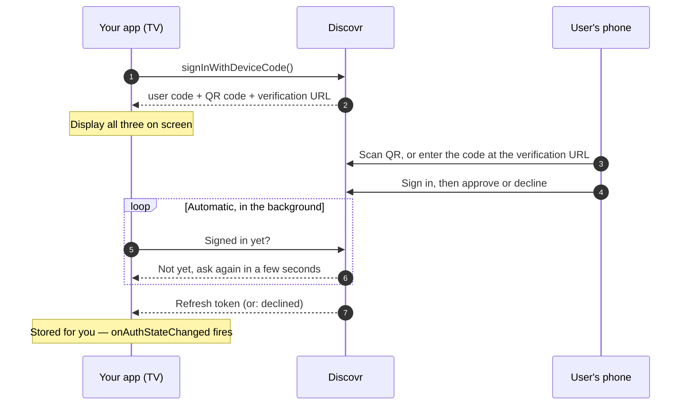

Use the device code flow for TVs, set-top boxes, IoT devices, or any app where you want second-screen sign-in. It's also the sign-in flow on Apple TV, where the Swift SDK's `signInWithWebAuth()` isn't available.

User sees a short code and QR code on the device. They scan the QR or enter the code on their phone or web browser. SDK polls in the background until authenticated.

## Getting started

<Steps>
	<Step title="Request device code">
		Call [`signInWithDeviceCode()`](/sdk-reference/authentication/sign-in-with-device-code). Returns
		a short numeric user code (e.g., "1234") and a QR code.
	</Step>
	<Step title="Display to user">
		Show the user code, render the QR code, and print the `verificationUrl` the result returns, so
		anyone who can't scan knows where to type the code. Tell user: "Sign in on your phone using this
		code or QR."
	</Step>
	<Step title="Wait for sign-in">
		SDK polls automatically, at the pace the server sets. Listen with
		[`onAuthStateChanged()`](/sdk-reference/authentication/on-auth-state-changed) (TypeScript) or
		`authState` / `authStateStream` (Kotlin/Swift) for completion. To also hear that the person
		declined or the code ran out, wait on the result's `completion`.
	</Step>
	<Step title="Sign-in confirmed">
		Once user authorizes on their other device, SDK receives refresh token and notifies you.
	</Step>
	<Step title="Select profile & call API">
		Call [`selectProfile()`](/sdk-reference/authentication/select-profile), then use `DiscovrClient`
		methods as normal.
	</Step>
</Steps>

<Tip>
	**On a TV**, pass `qrSize` (100 to 1000 pixels, 300 by default): 600 to 800 reads well from across
	the room. On tvOS, also move focus yourself once content appears after sign-in, because the system
	leaves it where it was.
</Tip>

<Tip>
	Building a UI to show this flow? [Branding](/guides/reference/branding) has the Discovr logos,
	colors, and ready-to-use button code.
</Tip>

## Code example

{/* sample: sign-in-device-code */}

<CodeGroup>

```typescript TypeScript
// Request a device code. unsubscribe() stops the background polling.
// On a TV, ask for a bigger QR code: 600-800 pixels reads well across a room.
const { userCode, qrCode, verificationUrl, unsubscribe } = await client.signInWithDeviceCode({
	qrSize: 700,
});
console.log(`Scan the QR code, or go to ${verificationUrl} and enter ${userCode}`);
// Render qrCode in your UI

// The SDK polls in the background and reports when sign-in finishes.
client.onAuthStateChanged(({ signedIn }) => {
	if (signedIn) {
		console.log("User authenticated on other device!");
		selectProfile();
	}
});

// Call unsubscribe() when the user leaves the screen.
```

```kotlin Kotlin
// On a TV, ask for a bigger QR code: 600-800 pixels reads well across a room.
val result = client.signInWithDeviceCode(qrSize = 700)
println("Scan the QR code, or go to ${result.verificationUrl} and enter ${result.userCode}")
// Render result.qrCode in your UI

// The SDK polls in the background and reports when sign-in finishes.
scope.launch {
    client.authState.collect { state ->
        if (state.signedIn) {
            println("Authenticated!")
            selectProfile()
        }
    }
}

// Cancel polling when the user navigates away: result.cancel()
```

```swift Swift
// On a TV, ask for a bigger QR code: 600-800 pixels reads well across a room.
let result = try await client.signInWithDeviceCode(qrSize: 700)
print("Scan the QR code, or go to \(result.verificationUrl) and enter \(result.userCode)")
// Render result.qrCode in your UI

// The SDK polls in the background and reports when sign-in finishes.
for await state in await client.authStateStream {
    if state.signedIn {
        print("Authenticated!")
        await selectProfile()
        break
    }
}

// Cancel polling when the user leaves the screen: result.cancel()
```

</CodeGroup>

## How it works

<Frame>
	
	
</Frame>

Three participants, and your app only writes the first and last step:



<Note>SDK handles polling automatically in background. Just listen for auth state changes.</Note>

<Tip>Great for second-screen UX: "Sign in on your phone while your content loads on TV."</Tip>

<Tip>
	**Developing without a phone handy?** On a client created with `demoMode`, the activation page
	also offers "Continue as Demo", so you can try the TV screens without a test account. That's for
	development; leave `demoMode` off in the build you ship.
</Tip>

## Handling sign-in errors

{/* sample: device-code-errors */}

<CodeGroup>

```typescript TypeScript
import { ClientNotFoundError, DiscovrClient, RateLimitedError } from "discovr";

try {
	const { userCode, qrCode, unsubscribe } = await client.signInWithDeviceCode();
	// Display userCode and qrCode to the user
	console.log(userCode, qrCode, unsubscribe);
} catch (err) {
	if (err instanceof ClientNotFoundError) {
		console.log("Invalid client ID. Check your configuration.");
	} else if (err instanceof RateLimitedError) {
		console.log(`Too many attempts. Try again in ${err.retryInSeconds}s.`);
	} else {
		console.log("Device code request failed:", err);
	}
}
```

```kotlin Kotlin
try {
    val result = client.signInWithDeviceCode()
    // Display result.userCode and result.qrCode to the user
    println("Code: ${result.userCode}")
} catch (e: ClientNotFoundError) {
    println("Invalid client ID. Check your configuration.")
} catch (e: RateLimitedError) {
    println("Too many attempts. Try again in ${e.retryInSeconds}s.")
} catch (e: Exception) {
    println("Device code request failed: ${e.message}")
}
```

```swift Swift
do {
    let result = try await client.signInWithDeviceCode()
    // Display result.userCode and result.qrCode to the user
    print("Code: \(result.userCode)")
} catch AuthError.clientNotFound {
    print("Invalid client ID. Check your configuration.")
} catch AuthError.rateLimited(let retryInSeconds) {
    print("Too many attempts. Try again in \(retryInSeconds)s.")
} catch {
    print("Device code request failed: \(error)")
}
```

</CodeGroup>

## When the flow ends without a sign-in

The person can decline on their phone, and a code lasts 10 minutes (`expiresIn`, in
**milliseconds**). Either way the SDK stops polling and tells you through the result's
`completion`, so you can say so on screen instead of leaving a dead code showing.

{/* sample: device-code-ending */}

<CodeGroup>

```typescript TypeScript
import {
	AuthCancelledError,
	DeviceCodeDeniedError,
	DeviceCodeExpiredError,
	DiscovrClient,
} from "discovr";

const { completion } = await client.signInWithDeviceCode();

try {
	// Settles when the flow ends. Resolves once the person approves on their phone.
	await completion;
	console.log("Signed in.");
} catch (err) {
	if (err instanceof DeviceCodeDeniedError) {
		console.log("They declined on their phone. Say so, and offer a new code.");
	} else if (err instanceof DeviceCodeExpiredError) {
		console.log("The code ran out. Show a fresh one.");
	} else if (err instanceof AuthCancelledError) {
		console.log("You stopped the flow with unsubscribe(). Nothing to show.");
	} else {
		throw err;
	}
}
```

```kotlin Kotlin
val result = client.signInWithDeviceCode()

try {
    // Completes when the flow ends. Returns once the person approves on their phone.
    result.completion.await()
    println("Signed in.")
} catch (e: DeviceCodeDeniedError) {
    println("They declined on their phone. Say so, and offer a new code.")
} catch (e: DeviceCodeExpiredError) {
    println("The code ran out. Show a fresh one.")
} catch (e: AuthCancelledError) {
    println("You stopped the flow with cancel(). Nothing to show.")
}
```

```swift Swift
let result = try await client.signInWithDeviceCode()

do {
    // Returns once the person approves on their phone.
    try await result.completion()
    print("Signed in.")
} catch AuthError.deviceCodeDenied {
    print("They declined on their phone. Say so, and offer a new code.")
} catch AuthError.deviceCodeExpired {
    print("The code ran out. Show a fresh one.")
} catch AuthError.cancelled {
    print("You stopped the flow with cancel(). Nothing to show.")
}
```

</CodeGroup>

<Note>
	The code on screen is the only thing the phone ever sees. The SDK keeps the secret it polls with
	to itself, and the QR code carries just the short code, so a photo of your TV can't be used to
	sign anyone in as someone else.
</Note>

## Advanced: Manual HTTP implementation

If building a custom client without the SDK:

<Expandable title="HTTP-level device code flow">

1. **Request device code**

   ```
   POST /auth/device-codes
   { "clientID": "..." }
   ```

   Response: `{ "deviceCode": "...", "userCode": "1234", "authQRCode": "...", "verificationUrl": "https://discovr.media/tv-auth", "expiresIn": 600000, "interval": 5 }`

   `deviceCode` is the value to poll with below, and it stays on your device: never show it or put it in the QR code. `userCode` is the short code to display to the user, with `verificationUrl` beside it for anyone who can't scan. Add `?size=700` for a bigger QR code.

2. **Poll for token** (wait `interval` seconds between polls)

   ```
   POST /auth/device-codes/{deviceCode}/poll
   ```

   Note the path param is the internal `deviceCode` from step 1, not the human-readable `userCode` shown on screen.

   While pending: `{ "status": "pending", "interval": 5 }`
   Once authorized: `{ "refreshToken": "...", "publicId": "...", "expiresAt": ... }`

   The `interval` is how many seconds to wait before the next poll. It grows the longer the code has been waiting, so use the latest value each time. If you get a `429`, wait the `retryAfterSeconds` it carries.

3. **Stop polling** when you get a refresh token, or an error. `401` with `device-code-denied` means the person declined on their phone; `device-code-expired` means the 10 minutes ran out; `device-code-already-consumed` means the code was already used.
   Then proceed to mint session token and call API.

</Expandable>

## Related SDK reference

[signInWithDeviceCode](/sdk-reference/authentication/sign-in-with-device-code) · [onAuthStateChanged](/sdk-reference/authentication/on-auth-state-changed) · [selectProfile](/sdk-reference/authentication/select-profile)

---

**Next:** [Signing out — the one exit, and what to use instead](/guides/authentication/signing-out)
