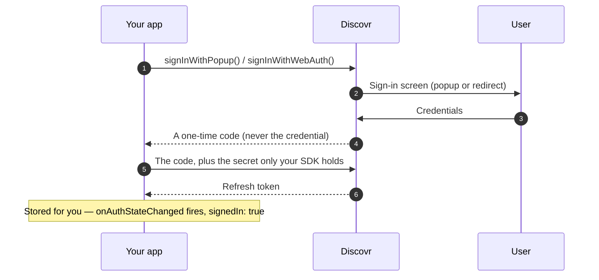

Use the web sign-in flow for web apps, mobile web apps, and any platform with a browser.

User sees a login popup (or redirects to login), enters credentials, and returns to your app signed in. Under the hood it is the standard authorization code flow with PKCE, so the long-lived credential never travels through the browser.

## Getting started

<Steps>
	<Step title="Initialize client">
		Create a `DiscovrClient` with your client ID (from your dashboard or contact support).
	</Step>
	<Step title="Call sign-in">
		Use [`signInWithPopup()`](/sdk-reference/authentication/sign-in-with-popup) (popup) or
		[`signInWithWebAuth()`](/sdk-reference/authentication/sign-in-with-web-auth) (redirect). Handle
		the result.
	</Step>
	<Step title="Verify sign-in">
		Check if [`isSignedIn()`](/sdk-reference/authentication/is-signed-in) is true. SDK stores
		refresh token securely.
	</Step>
	<Step title="Select a profile">
		Call [`getProfiles()`](/sdk-reference/profiles/get-profiles), let user pick one, then
		[`selectProfile()`](/sdk-reference/authentication/select-profile) with the chosen profile id.
		This mints a session token.
	</Step>
	<Step title="Ready to call API">
		Use `DiscovrClient` methods like [`createPage()`](/sdk-reference/pages/create-page),
		[`getRows()`](/sdk-reference/rows/get-rows). SDK injects session token automatically.
	</Step>
</Steps>

<Tip>
	Need a sign-in button to trigger this flow? [Branding](/guides/reference/branding) has logos,
	colors, and code for every platform.
</Tip>

## Code example

`signInWithWebAuth()` doesn't take the same arguments on every platform — TypeScript takes a single redirect URL, Kotlin also takes a callback that launches that URL (Custom Tabs, `Intent.ACTION_VIEW`), and Swift also takes a presentation anchor and is `async throws`. The examples below show each language's actual call shape, not an idealized shared one.

{/* sample: authentication-web-sign-in-code-example */}

<CodeGroup>

```typescript TypeScript
import { DiscovrClient } from "discovr";

const client = new DiscovrClient("your-client-id");

// Sign in with popup (web) or redirect
await client.signInWithPopup();

// List profiles and pick one
const { profiles } = await client.getProfiles();
await client.selectProfile(profiles[0].id);

// Ready to call API
const page = await client.createPage();
console.log("Ready — created page:", page.id);
```

```kotlin Kotlin
import android.content.Context
import android.content.Intent
import android.net.Uri
import api.discovr.DiscovrClient

fun startWebSignIn(client: DiscovrClient, context: Context) {
    client.signInWithWebAuth("com.example.app://auth/callback") { url ->
        // Launch the URL via Custom Tabs or a plain browser Intent.
        context.startActivity(Intent(Intent.ACTION_VIEW, Uri.parse(url)))
    }
}

// Call this when your redirect intent-filter receives the callback.
suspend fun finishWebSignIn(client: DiscovrClient, uri: String) {
    if (!client.handleRedirectUri(uri)) return

    // List profiles
    val profiles = client.getProfiles().profiles

    // Select first profile
    client.selectProfile(profiles.first().id)

    println("Signed in, profile active")
}
```

```swift Swift
import AuthenticationServices
import Discovr

@MainActor
func signInWithWeb(client: DiscovrClient, presentationAnchor: ASPresentationAnchor) async {
    do {
        try await client.signInWithWebAuth(
            redirectUri: "com.example.app://auth/callback",
            presentationAnchor: presentationAnchor
        )

        // List profiles
        let profiles = try await client.getProfiles()

        // Select first profile
        try await client.selectProfile(profileId: profiles.profiles[0].id)

        print("Signed in, profile active")
    } catch {
        print("Sign-in failed: \(error)")
    }
}
```

</CodeGroup>

## How it works

<Frame>
	
	
</Frame>

Two participants, and the whole exchange happens without your app handling a credential:



<Note>
	The SDK stores the refresh token and keeps the credential behind your API calls current. You never
	touch either. Where the token lives depends on the platform — see
	[Security](/guides/reference/security).
</Note>

<Tip>
	Use popups for better UX in web apps. Use redirects for mobile apps built with frameworks like
	React Native or Flutter.
</Tip>

## Registering your redirect URL

**Only the redirect flow needs one.** `signInWithPopup()` hands a one-time code straight back to the page that opened the popup, so there is no callback URL to register and nothing to configure — if that's your whole integration, you can skip this section. `signInWithWebAuth()` is the one that sends the user away and brings them back, and that return address has to be registered in advance.

Every redirect URL you pass to `signInWithWebAuth()` must be registered on your client in the Discovr dashboard, under **Clients → Redirect URLs**. Sign-in fails before the consent screen if it isn't — so a stolen client ID can't be used to send someone's session anywhere else.

| Your app      | Register                              | Notes                                                                                       |
| ------------- | ------------------------------------- | ------------------------------------------------------------------------------------------- |
| Web           | `https://yourapp.com/callback`        | Must be `https`.                                                                            |
| iOS / Android | `com.yourcompany.app://auth/callback` | A reverse-DNS scheme you own. **No website required.**                                      |
| Desktop / CLI | `http://127.0.0.1/callback`           | The port is matched as a wildcard, so binding an ephemeral port at runtime works.           |
| TV / set-top  | —                                     | Use the [device code flow](/guides/authentication/device-code) instead; it has no redirect. |

**Matching rules.** The comparison is exact on scheme, host, port, and path, with three deliberate exceptions: a trailing slash is ignored, query strings on the incoming request are ignored (and preserved on the way back, so you can round-trip your own state), and loopback ports are wildcarded. Paths are case-sensitive.

<Note>
	Native app schemes must contain a dot — `com.yourcompany.app://` works, `myapp://` doesn't. A bare
	scheme can be registered by any other app on the same device, which would let it intercept the
	callback. Using a domain you own prevents that.
</Note>

For native apps, declare the scheme with an `intent-filter` on Android or `CFBundleURLTypes` on iOS so the OS routes the callback back to your app.

## Handling sign-in errors

{/* sample: authentication-web-sign-in-handling-sign-in-errors */}

<CodeGroup>

```typescript TypeScript
import { AuthCancelledError, DiscovrClient } from "discovr";

try {
	await client.signInWithPopup();
} catch (err) {
	if (err instanceof AuthCancelledError) {
		// They closed the window or pressed Cancel. Usually best answered with silence.
		console.log("User cancelled sign-in");
	} else if (err instanceof Error && err.message.startsWith("Failed to open popup")) {
		console.log("Popup blocked. Allow popups for this site and retry.");
	} else {
		console.log("Sign-in failed:", err);
		// Show user: "Sign-in failed. Try again."
	}
}
```

```kotlin Kotlin
suspend fun completeWebSignIn(client: DiscovrClient, uri: String) {
    try {
        if (client.handleRedirectUri(uri)) {
            println("Sign-in successful")
        } else {
            println("That link was not a sign-in return.")
        }
    } catch (e: AuthCancelledError) {
        // They closed the browser or pressed Cancel. Usually best answered with silence.
        println("User cancelled sign-in")
    } catch (e: IllegalStateException) {
        // The state check failed: this return is not one the app started.
        println("Sign-in failed: ${e.message}")
    } catch (e: DiscovrError) {
        println("Sign-in failed: ${e.message}")
    }
}
```

```swift Swift
import AuthenticationServices
import Discovr

@MainActor
func handleSignInWithErrorHandling(client: DiscovrClient, presentationAnchor: ASPresentationAnchor) async {
    do {
        try await client.signInWithWebAuth(
            redirectUri: "com.example.app://auth/callback",
            presentationAnchor: presentationAnchor
        )
        print("Sign-in successful")
    } catch AuthError.cancelled {
        // They closed the sheet or pressed Cancel. Usually best answered with silence.
        print("User cancelled sign-in")
    } catch let error as AuthError {
        print("Sign-in failed: \(error)")
    } catch {
        print("Sign-in failed: \(error)")
    }
}
```

</CodeGroup>

**Common cases:**

- **User cancels:** User closes the popup or presses Cancel. You get an `AuthCancelledError` (Swift: `AuthError.cancelled`), usually best answered with silence.
- **Network error:** No internet or timeout. Show retry button.
- **Invalid credentials:** User enters wrong email/password. SDK shows Discovr login UI, let user retry.

<Warning>
	Never put refresh tokens in URLs or logs. You will not have to: what crosses the browser is a
	one-time code that is useless without a secret that stays in your app until the SDK redeems it.
</Warning>

## Advanced: Manual HTTP implementation

Nothing about this flow is SDK-exclusive. The three official SDKs are a convenience layer over the same HTTP endpoints documented here — if you're integrating from a language we don't ship an SDK for (Python, Go, a shell script, a server-side job), you can drive the flow directly by calling them yourself.

<Expandable title="HTTP-level web flow">

1. **Generate a `state` and a PKCE pair yourself, and redirect the user's browser**

   An SDK does all of this for you; a manual integration takes it on, the same way any hand-rolled OAuth integration does in any language. Generate:
   - a random, unguessable `state`, and remember it (e.g. in your own session);
   - a random `codeVerifier` of 43 to 128 characters (32 random bytes, base64url, is 43), and remember that too, **but never put it in a URL**;
   - the `code_challenge`: the SHA-256 of the verifier, base64url-encoded without padding.

   Then send the user's browser to:

   ```
   GET /auth/web/authorize?clientID=YOUR_CLIENT_ID&redirectURL=YOUR_CALLBACK&state=YOUR_STATE&codeChallenge=YOUR_CHALLENGE&codeChallengeMethod=S256
   ```

   Both challenge parameters are required, and `S256` is the only method. This is a plain top-level browser redirect — not a popup, not an API call your server makes — to Discovr's own hosted sign-in page. The user's password (or Google credentials) go to Discovr's login UI, never to your app.

2. **Handle the callback, then redeem the code**

   Once the user signs in, their browser is redirected back to your own registered `redirectURL`, with a one-time `code` (or an `error`) and your `state`:

   ```
   YOUR_CALLBACK?code=...&state=YOUR_STATE
   YOUR_CALLBACK?error=authorization-cancelled&state=YOUR_STATE
   ```

   Compare the returned `state` against the value you generated in step 1. If it doesn't match, reject the callback — this comparison is the entire CSRF defense, and nothing else performs it on your behalf in a manual integration. Then trade the code for the credential from wherever you kept the verifier. The request carries no secret of its own, so a browser app can make it directly:

   ```
   POST /auth/web/token
   { "clientID": "YOUR_CLIENT_ID", "code": "...", "codeVerifier": "YOUR_VERIFIER" }
   ```

   Response: `{ "refreshToken": "...", "publicId": "...", "expiresAt": ... }`

   The code works once and lives 60 seconds. A wrong `codeVerifier` fails **and spends the code**, so start a new sign-in rather than retrying.

3. **Mint a session token**

   ```
   POST /auth/session-token
   Authorization: Bearer <refreshToken>
   { "profileId": "..." }
   ```

   Response: `{ "sessionToken": "...", "snapshotId": "...", "expiresAt": ... }`

4. **Use the session token for API calls**

   ```
   GET /pages
   Authorization: Bearer <sessionToken>
   ```

   Everything from here is plain, already-documented REST — nothing about `/pages`, `/profile/*`, or any other endpoint is SDK-specific.

**No web server of your own?** Register a loopback redirect URL instead — `http://127.0.0.1/callback` — and the port is matched as a wildcard, so a local CLI tool or desktop app can bind whatever ephemeral port it gets at runtime and still complete step 2 above.

**What you can't call directly:** the step Discovr's own hosted sign-in page uses to approve a request and issue the code isn't documented for direct use, and isn't callable by a third-party integration; it requires a credential only that page is in a position to obtain. Steps 1 and 2 above are the supported way to get a refresh token without the SDK.

</Expandable>

## Related SDK reference

[signInWithPopup](/sdk-reference/authentication/sign-in-with-popup) · [signInWithWebAuth](/sdk-reference/authentication/sign-in-with-web-auth) · [getProfiles](/sdk-reference/profiles/get-profiles) · [selectProfile](/sdk-reference/authentication/select-profile) · [createPage](/sdk-reference/pages/create-page) · [getRows](/sdk-reference/rows/get-rows)

---

**Next:** [Signing out — the one exit, and what to use instead](/guides/authentication/signing-out)
