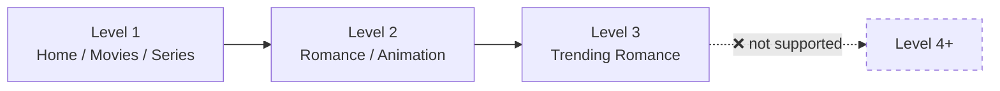

When your user opens a Discovr-powered app, they sign in, pick a profile, and browse content. This guide walks through the canonical **navigation model** so your app feels native and predictable.

The core pattern is simple: start with a **profile selector**, then browse **tabbed pages** (Home, Movies, Series). Tapping a **navigation row** (like "Romance" or "Animation") **drills into a new page** with that filter applied—giving you a natural **breadcrumb stack**. Discovr enforces a **three-level depth limit** to prevent navigation so deep users can't find their way back.

<Note>
	This guide assumes a signed-in user with a profile selected. If you're not there yet, start with
	[Authentication](/guides/authentication). Code snippets use **TypeScript**, **Kotlin**, and
	**Swift** tabs — select your language to follow along.
</Note>

## Where this guide starts

Everything below assumes the user has signed in and picked a profile — that walkthrough lives in
[Listing and selecting profiles](/guides/profiles/listing-and-selecting-profiles). From the moment a
profile is active, the browse experience is yours to build.

## Home/Movies/Series Tabs

Once on Home, users typically see **top-level tabs** (Home, Movies, Series) that let them browse by media type. Each tab is a **separate page** with different filters.

Create each page once and reuse its ID. Switching tabs doesn't recreate the page—it just swaps the visible rows.

{/* sample: navigation-home-movies-series-tabs */}

<CodeGroup>

```typescript TypeScript
// Create pages for each tab once, on app launch or after sign-in
const tabs = {
	home: await client.createPage({ name: "Home" }),
	movies: await client.createPage({
		pageFilters: { mediaType: "movie" },
		name: "Movies",
	}),
	series: await client.createPage({
		pageFilters: { mediaType: "tv" },
		name: "Series",
	}),
};

// Later: user taps "Movies" tab
const moviesData = await client.getPage(tabs.movies.id);
renderPage(moviesData); // Display Movies tab rows
```

```kotlin Kotlin
// Create pages for each tab once, on app launch or after sign-in
val tabs = mapOf(
    "home" to client.createPage(name = "Home"),
    "movies" to client.createPage(
        pageFilters = FilterSpec(mediaType = FilterSpec.MediaType.movie),
        name = "Movies"
    ),
    "series" to client.createPage(
        pageFilters = FilterSpec(mediaType = FilterSpec.MediaType.tv),
        name = "Series"
    )
)

// Later: user taps "Movies" tab
val moviesData = client.getPage(tabs["movies"]!!.id)
renderPage(moviesData) // Display Movies tab rows
```

```swift Swift
// Create pages for each tab once, on app launch or after sign-in
let tabs = [
    "home": try await client.createPage(name: "Home"),
    "movies": try await client.createPage(
        pageFilters: FilterSpec(mediaType: .movie),
        name: "Movies"
    ),
    "series": try await client.createPage(
        pageFilters: FilterSpec(mediaType: .tv),
        name: "Series"
    ),
]

// Later: user taps "Movies" tab
let moviesData = try await client.getPage(pageId: tabs["movies"]!.id)
renderPage(moviesData) // Display Movies tab rows
```

</CodeGroup>

<Tip>
	Each tab is a **distinct page with its own snapshot**. This means Home and Movies never
	interfere—they paginate independently, and switching tabs doesn't lose your place in the other
	one.
</Tip>

## Drill-Down with Navigation Rows

Some rows are **navigation-type rows** (not media). Instead of displaying movies, they display **drill-down destinations**: "Romance", "Animation", "Trending", etc.

When the user taps one, you push its pre-created **page ID** onto your navigation stack and load it—no page creation needed.

<Steps>
	<Step title="Identify navigation rows">
		Rows come in types. **Navigation rows** have `type: "navigation"`. When you fetch rows, check the type.

    	{/* sample: navigation-drill-down-with-navigation-rows */}

    	<CodeGroup>

```typescript TypeScript
const { rows } = await client.getRows(homePageId);
rows.forEach((row) => {
	if (row.type === "navigation") {
		console.log(`Navigation row: ${row.title}`);
	}
});
```

```kotlin Kotlin
val rows = client.getRows(homePageId).rows
rows.forEach { row ->
    if (row.type == RowType.navigation) {
        println("Navigation row: ${row.title}")
    }
}
```

```swift Swift
let rows = try await client.getRows(pageId: homePageId).rows
for row in rows where row.type == .navigation {
    print("Navigation row: \(row.title)")
}
```

    	</CodeGroup>
    </Step>

    <Step title="Fetch items in the navigation row">
    	Call [`getRowItems()`](/sdk-reference/rows/get-row-items) to get the destinations in that row (e.g., genre names). Each navigation item already carries a `pageId`.

    	{/* sample: navigation-drill-down-with-navigation-rows-2 */}

    	<CodeGroup>

```typescript TypeScript
const navRow = rows.find((r) => r.type === "navigation");
if (navRow) {
	const { items } = await client.getRowItems(homePageId, navRow.id);
	items.forEach((item) => {
		if (item.type === "navigation") {
			console.log(`Destination: ${item.title} → page ${item.pageId}`);
		}
	});
}
```

```kotlin Kotlin
val navRow = rows.first { it.type == RowType.navigation }
val items = client.getRowItems(homePageId, navRow.id).items
items.filterIsInstance<NavigationItem>().forEach { item ->
    println("Destination: ${item.title} → page ${item.pageId}")
}
```

```swift Swift
let navRow = rows.first(where: { $0.type == .navigation })!
let items = try await client.getRowItems(pageId: homePageId, rowId: navRow.id).items
for case .typeNavigationItem(let item) in items {
    print("Destination: \(item.title) → page \(item.pageId)")
}
```

    	</CodeGroup>
    </Step>

    <Step title="Push the page ID when the user taps a destination">
    	Navigation items already link to their destination page. When tapped, push the item's `pageId` onto your stack and load it.

    	{/* sample: navigation-drill-down-with-navigation-rows-3 */}

    	<CodeGroup>

```typescript TypeScript
// User taps "Romance" in the navigation row
const romance = items.find((i) => i.type === "navigation" && i.title === "Romance");

if (romance?.type === "navigation") {
	// Push the pre-existing page ID onto your navigation stack
	navigationStack.push({ id: romance.pageId, name: romance.title });
	const pageData = await client.getPage(romance.pageId);
	renderPage(pageData);
}
```

```kotlin Kotlin
// User taps "Romance" in the navigation row
val romance = items.filterIsInstance<NavigationItem>().first { it.title == "Romance" }

// Push the pre-existing page ID onto your navigation stack
navigationStack.add(PageEntry(id = romance.pageId, name = romance.title))
val pageData = client.getPage(romance.pageId)
renderPage(pageData)
```

```swift Swift
// User taps "Romance" in the navigation row
let romance = items.compactMap { item -> NavigationItem? in
    if case .typeNavigationItem(let nav) = item { return nav }
    return nil
}.first { $0.title == "Romance" }!

// Push the pre-existing page ID onto your navigation stack
navigationStack.append(PageEntry(id: romance.pageId, name: romance.title))
let pageData = try await client.getPage(pageId: romance.pageId)
renderPage(pageData)
```

    	</CodeGroup>
    </Step>

</Steps>

## Breadcrumbs

Each page's `name` field **is** the breadcrumb for that level—"Home", "Movies", "Anime", "Romance". [`getPage()`](/sdk-reference/pages/get-page) returns it directly, so you don't need to maintain a separate label list.

`name` is set when you passed one to [`createPage()`](/sdk-reference/pages/create-page), and on pages you reached through a navigation tile, which carry their own. It's optional on the response, so fall back to a label of your own when it's absent.

To build the full breadcrumb trail ("Home > Movies > Anime"), map your navigation stack (page IDs you've already loaded) to their titles:

{/* sample: navigation-breadcrumbs */}

<CodeGroup>

```typescript TypeScript
// navigationStack: [{ id: "...", name: "Home" }, { id: "...", name: "Movies" }, ...]
const breadcrumbTrail = navigationStack.map((p) => p.name).join(" > ");
// "Home > Movies > Anime"
```

```kotlin Kotlin
// navigationStack: List<PageEntry> with id and name
val breadcrumbTrail = navigationStack.joinToString(" > ") { it.name.orEmpty() }
// "Home > Movies > Anime"
```

```swift Swift
// navigationStack: [PageEntry] with id and name
let breadcrumbTrail = navigationStack.compactMap { $0.name }.joined(separator: " > ")
// "Home > Movies > Anime"
```

</CodeGroup>

When you push a page onto the stack, store its title alongside its ID so you can render the trail without extra fetches:

{/* sample: navigation-breadcrumbs-2 */}

<CodeGroup>

```typescript TypeScript
// On tap:
const pageData = await client.getPage(romanceItem.pageId);
navigationStack.push({ id: romanceItem.pageId, name: pageData.name ?? romanceItem.title });
```

```kotlin Kotlin
// On tap:
val pageData = client.getPage(romanceItem.pageId)
navigationStack.add(PageEntry(id = romanceItem.pageId, name = pageData.name ?: romanceItem.title))
```

```swift Swift
// On tap:
let pageData = try await client.getPage(pageId: romanceItem.pageId)
navigationStack.append(PageEntry(id: romanceItem.pageId, name: pageData.name ?? romanceItem.title))
```

</CodeGroup>

## Back Behavior

When the user taps **back**, pop the current entry from your stack and redisplay the previous one. The page is unchanged unless recommendations have refreshed in the meantime, so the user lands where they left off.

{/* sample: navigation-back-behavior */}

<CodeGroup>

```typescript TypeScript
async function goBack() {
	if (navigationStack.length > 1) {
		navigationStack.pop(); // Remove current page
		const previous = navigationStack[navigationStack.length - 1];
		const pageData = await client.getPage(previous.id);
		renderPage(pageData); // Show the previous page (same snapshot)
	}
}
```

```kotlin Kotlin
suspend fun goBack() {
    if (navigationStack.size > 1) {
        navigationStack.removeAt(navigationStack.size - 1)
        val previous = navigationStack.last()
        val pageData = client.getPage(previous.id)
        renderPage(pageData)
    }
}
```

```swift Swift
func goBack() async throws {
    if navigationStack.count > 1 {
        navigationStack.removeLast()
        let previous = navigationStack.last!
        let pageData = try await client.getPage(pageId: previous.id)
        renderPage(pageData)
    }
}
```

</CodeGroup>

<Check>
	A navigation stack of page IDs is safe to keep for as long as you like — across a recommendations
	refresh, a profile switch, or an app restart. Page IDs don't expire.
</Check>

## Three-Level Depth Limit

Discovr enforces a **maximum of three nesting levels** (not counting the root Home). Think of it as:

- **Level 1:** Home / Movies / Series (root pages)
- **Level 2:** Romance / Animation (drill from Level 1)
- **Level 3:** Trending Romance (drill from Level 2)



Trying to drill deeper is not supported. Design your UX so navigation destinations don't nest more than three levels.

<Warning>
	If you try to create a page at depth 4+, the operation may fail or behave unexpectedly. Always cap
	your navigation stack at 3 levels and prevent the user from drilling further.
</Warning>

{/* sample: navigation-three-level-depth-limit */}

<CodeGroup>

```typescript TypeScript
function canDrillDeeper(): boolean {
	// Home=1, Movies=2, Romance=3. Depth limit is 3.
	return navigationStack.length < 3;
}

// Before creating a new page on navigation tap:
if (canDrillDeeper()) {
	const newPage = await client.createPage({ pageFilters });
	navigationStack.push({ id: newPage.id });
} else {
	showToast("Cannot drill deeper. Try another category.");
}
```

```kotlin Kotlin
fun canDrillDeeper(): Boolean = navigationStack.size < 3

// Before creating a new page on navigation tap:
suspend fun drillDeeper(client: DiscovrClient, pageFilters: FilterSpec) {
    if (canDrillDeeper()) {
        val newPage = client.createPage(pageFilters = pageFilters)
        navigationStack.add(PageEntry(id = newPage.id))
    } else {
        showToast("Cannot drill deeper.")
    }
}
```

```swift Swift
func canDrillDeeper() -> Bool {
    return navigationStack.count < 3
}

// Before creating a new page on navigation tap:
func drillDeeper(client: DiscovrClient, pageFilters: FilterSpec) async throws {
    if canDrillDeeper() {
        let newPage = try await client.createPage(pageFilters: pageFilters)
        navigationStack.append(PageEntry(id: newPage.id))
    } else {
        showToast("Cannot drill deeper.")
    }
}
```

</CodeGroup>

## Continue Watching on Home

Most apps show a **"Continue Watching"** row between the hero and recommendation rows on the Home page. This row comes from **profile context**, not from the page itself.

Fetch it separately and insert it into your Home UI:

{/* sample: navigation-continue-watching-on-home */}

<CodeGroup>

```typescript TypeScript
const [homePageData, continueWatching] = await Promise.all([
	client.getPage(homePageId),
	client.getPlaybackItems().then((playback) => playback.items), // Continue Watching = playback list
]);

// In your UI:
// 1. Render hero from homePageData.hero
// 2. Render continueWatching row
// 3. Render homePageData.rows below
```

```kotlin Kotlin
val homePageData = client.getPage(homePageId)
val continueWatching = client.getPlaybackItems().items // Playback list = Continue Watching

// Render hero, then Continue Watching row, then recommendation rows
```

```swift Swift
async let homePageData = client.getPage(pageId: homePageId)
async let playback = client.getPlaybackItems()

let pageData = try await homePageData
let continueWatching = try await playback.items // Playback list = Continue Watching

// Render hero, Continue Watching, then rows
print(pageData.hero.count, continueWatching.count)
```

</CodeGroup>

See [Profile Context](/guides/profile-context) for full details on Continue Watching, watchlists, and other user state.

## Putting It Together

Here's a skeleton of how navigation typically flows in a Discovr app:

1. User signs in
2. Profile picker shows available profiles
3. User selects a profile → Home loads with hero + rows
4. Tabs (Home, Movies, Series) each have their own page ID
5. User taps a navigation row item (e.g., "Romance") → new page is created and pushed onto the stack
6. Breadcrumb updates (Home > Movies > Romance)
7. User taps back → pop the stack, redisplay the previous page
8. Continue Watching appears between hero and rows on Home

<Note>
	If the user browses past the 30-minute window and taps a page from earlier in their stack, it
	loads normally — with refreshed recommendations behind it. See
	[Recommendations](/guides/recommendations) for how to notice that happened.
</Note>

## Related Reading

- [Recommendations](/guides/recommendations) — why page IDs never change, and what to do when the rows behind them do
- [Lazy Loading & Performance](/guides/navigation/lazy-loading) — Load navigation efficiently
- [Pages Overview](/guides/pages) — Page structure and the hero carousel
- [Rows Overview](/guides/rows) — Row types and pagination

---

**Next:** [Lazy loading & performance — load a page in the right order](/guides/navigation/lazy-loading)
