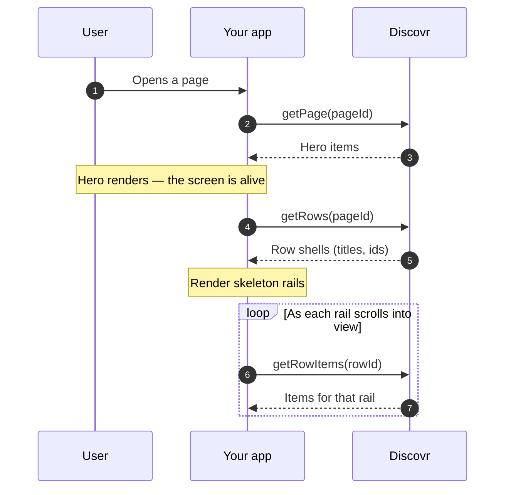

You've built navigation and profiles. Now make your app feel fast. This guide walks through the loading patterns that keep Discovr apps responsive.

The core idea is simple: **load in priority order**. Hero → rows → items. Show the user something immediately, then fill in the rest as they scroll.

| Load phase         | What you fetch              | When                     |
| ------------------ | --------------------------- | ------------------------ |
| Immediate          | `getPage()` hero            | On page open             |
| After hero renders | `getRows()` row shells      | After hero visible       |
| On scroll          | `getRowItems()` for one row | When row enters viewport |
| Pagination         | More items / rows           | When user reaches end    |

<Note>
	This guide assumes you understand pages (hero + rows) and snapshots. If not, start with [Pages
	Overview](/guides/pages) and [Recommendations](/guides/recommendations). Code snippets use
	**TypeScript**, **Kotlin**, and **Swift** tabs.
</Note>

## Page Load Strategy: Hero First

When the user opens a page, **load the hero carousel immediately**. Rows can come later — the point is that the screen is never blank while you wait for everything.



In short: hero first, then row shells, then items per rail as they come into view.

{/* sample: navigation-lazy-loading-page-load-strategy-hero-first */}

<CodeGroup>

```typescript TypeScript
async function loadPageEfficiently(pageId: string) {
	// Step 1: Fetch hero (fast)
	const pageData = await client.getPage(pageId);
	renderHero(pageData.hero); // User sees hero immediately

	// Step 2: Fetch rows lazily (after user sees hero)
	const { rows } = await client.getRows(pageId);

	// Step 3: Set up Intersection Observer for each row
	rows.forEach((row) => {
		const observer = new IntersectionObserver((entries) => {
			entries.forEach(async (entry) => {
				if (entry.isIntersecting) {
					// Row is visible; fetch its items
					const { items } = await client.getRowItems(pageId, row.id);
					renderRow(row, items);
					observer.unobserve(entry.target);
				}
			});
		});

		const rowElement = document.getElementById(`row-${row.id}`);
		if (rowElement) observer.observe(rowElement);
	});
}

loadPageEfficiently(homePageId);
```

```kotlin Kotlin
suspend fun loadPageEfficiently(pageId: String) {
    // Fetch hero first
    val pageData = client.getPage(pageId)
    renderHero(pageData.hero)

    // Fetch rows
    val rows = client.getRows(pageId).rows

    // Observe each row for visibility
    rows.forEach { row ->
        observeRowVisibility(pageId, row) { isVisible ->
            if (isVisible) {
                viewModelScope.launch {
                    val items = client.getRowItems(pageId, row.id).items
                    renderRow(row, items)
                }
            }
        }
    }
}

fun observeRowVisibility(
    pageId: String,
    row: Row,
    callback: (Boolean) -> Unit
) {
    // Implementation depends on your UI framework
    // e.g., for Compose or View-based, use layout listeners
}
```

```swift Swift
func loadPageEfficiently(pageId: String) async throws {
    // Fetch hero first
    let pageData = try await client.getPage(pageId: pageId)
    renderHero(pageData.hero)

    // Fetch rows
    let rows = try await client.getRows(pageId: pageId).rows

    // Observe each row for visibility
    for row in rows {
        observeRowVisibility(row: row) { isVisible in
            if isVisible {
                Task {
                    guard let page = try? await client.getRowItems(pageId: pageId, rowId: row.id) else { return }
                    renderRow(row, page.items)
                }
            }
        }
    }
}

func observeRowVisibility(row: Row, callback: @escaping (Bool) -> Void) {
    // Use UIView visibility APIs or SwiftUI observers
}
```

</CodeGroup>

<Tip>
	**Metrics:** Measure "Time to Hero" (how long until the hero appears). This is the user's first
	impression of load speed. 1-2 seconds is typical; anything over 3 seconds feels slow.
</Tip>

```
Page load timeline:

0ms    - User taps Home
200ms  - Fetch getPage() (hero data)
300ms  - HERO VISIBLE TO USER (KEY MILESTONE)
400ms  - Fetch getRows() (row metadata)
500ms  - Rows appear below hero
...
1200ms - Row 1 becomes visible
1300ms - Fetch getRowItems() for Row 1
1500ms - Row 1 items render
...
3000ms - Row 2 becomes visible
3100ms - Fetch getRowItems() for Row 2

Result: Hero in 300ms, rows by 500ms, items on demand.
Total bandwidth: only what's visible.
```

## Row Item Pagination: Load on Scroll

Rows include pagination tokens (`nextPageToken`, `hasMore`). Don't fetch all items upfront. Fetch them as the user scrolls within the row.

{/* sample: navigation-lazy-loading-row-item-pagination-load-on-scroll */}

<CodeGroup>

```typescript TypeScript
async function loadRowItemsOnScroll(pageId: string, row: Row) {
	// Fetch the first page of items
	let page = await client.getRowItems(pageId, row.id);
	let items: RowItem[] = page.items;
	renderItems(items);

	// Watch for scroll near the end
	const container = document.getElementById(`row-${row.id}`);
	const observer = new IntersectionObserver((entries) => {
		entries.forEach(async (entry) => {
			if (entry.isIntersecting && page.hasMore && page.nextPageToken) {
				// User scrolled near the end; fetch the next page
				page = await client.getRowItems(pageId, row.id, {
					nextPageToken: page.nextPageToken,
				});
				items = [...items, ...page.items];
				renderItems(items);
			}
		});
	});

	if (container) observer.observe(container);
}
```

```kotlin Kotlin
suspend fun loadRowItemsOnScroll(pageId: String, row: Row) {
    var page = client.getRowItems(pageId, row.id)
    var items = page.items
    renderItems(items)

    // When user scrolls near the end
    observeScrollNearEnd(row) {
        val token = page.nextPageToken
        if (page.hasMore && token != null) {
            viewModelScope.launch {
                page = client.getRowItems(pageId, row.id, nextPageToken = token)
                items = items + page.items
                renderItems(items)
            }
        }
    }
}
```

```swift Swift
@MainActor
func loadRowItemsOnScroll(pageId: String, row: Row) async throws {
    var page = try await client.getRowItems(pageId: pageId, rowId: row.id)
    var items = page.items
    renderItems(items)

    // Observe for scroll near end
    observeScrollNearEnd(row: row) {
        guard page.hasMore, let token = page.nextPageToken else { return }
        Task {
            guard let next = try? await client.getRowItems(pageId: pageId, rowId: row.id, nextPageToken: token) else { return }
            page = next
            items += next.items
            renderItems(items)
        }
    }
}
```

</CodeGroup>

**Why?** A row might have 100 items. The user might only see the first 10 before scrolling to a different row. Why download 90 items they'll never see?

## Image Lazy Loading

Media items include image URLs. Use the browser's native `loading="lazy"` attribute or an Intersection Observer to defer image fetches until the image is near the viewport.

{/* sample: navigation-lazy-loading-image-lazy-loading */}

<CodeGroup>

```typescript TypeScript
// Native lazy loading (simplest)
function renderMediaItem(item: { posterPath?: Record<string, string>; title: string }) {
	const img = document.createElement("img");
	img.src = item.posterPath?.w185 ?? ""; // Pick the size you need — see the Tip below
	img.loading = "lazy"; // Browser defers load until visible
	img.alt = item.title;
	return img;
}

// Or with Intersection Observer (more control)
function observeImageVisibility(img: HTMLImageElement) {
	const observer = new IntersectionObserver((entries) => {
		entries.forEach((entry) => {
			if (entry.isIntersecting) {
				img.src = img.dataset.src ?? ""; // Load on visibility
				observer.unobserve(img);
			}
		});
	});
	observer.observe(img);
}
```

```kotlin Kotlin
// In your Image composable (Jetpack Compose)
@Composable
fun MediaItemImage(posterPath: Map<String, String>) {
    AsyncImage(
        model = posterPath["w185"], // Pick the size you need — see the Tip below
        contentDescription = "Media poster",
        contentScale = ContentScale.Crop,
        modifier = Modifier.fillMaxSize()
    )
}

// Compose handles lazy loading automatically for
// images in scrollable lists
```

```swift Swift
// SwiftUI view that loads the poster lazily
struct MediaItemImage: View {
    let posterPath: [String: String]

    var body: some View {
        AsyncImage(url: URL(string: posterPath["w185"] ?? "")) { image in // Pick the size you need — see the Tip below
            image
                .resizable()
                .scaledToFill()
        } placeholder: {
            Color.gray
        }
    }
}

// Or with custom URLSession to control cache/loading
```

</CodeGroup>

**Why?** Images are heavy. Downloading 50 poster images (10MB+) upfront kills network speed and battery life. Lazy loading fetches them only when needed.

<Tip>
	Every image field (`poster_path`, `backdrop_path`, `logo_path`, `still_path`, and provider
	`logos`/nav `paths`) is a map of size key to URL, not a single URL. Pick the smallest size that
	still looks sharp for where you're rendering it — a 200x300 thumbnail should use `w185`, not
	`original`. Poster, backdrop, still and logo images come in `w45`, `w92`, `w154`, `w185`, `w300`,
	`w342`, `w500`, `w780`, `w1280`, and `original`; use `w1280` for full-bleed backdrops on a TV or a
	large window rather than jumping to `original`. Provider logos are keyed by pixel dimension
	instead (`60`, `100`, `512`, `1024`). This can cut the image payload by more than half compared to
	always requesting `original`.
</Tip>

## Combined Pattern: Full Home Page

Here's a complete example tying everything together:

{/* sample: navigation-lazy-loading-combined-pattern-full-home-page */}

<CodeGroup>

```typescript TypeScript
async function loadHomePageEfficiently(homePageId: string) {
	// 1. Load hero immediately
	const pageData = await client.getPage(homePageId);
	renderHero(pageData.hero);

	// 2. Insert "Continue Watching" row from profile context
	const { items: continueWatching } = await client.getPlaybackItems({ limit: 10 });
	renderContinueWatchingRow(continueWatching);

	// 3. Fetch recommendation rows, but not their items yet
	const { rows } = await client.getRows(homePageId);
	const loaded = new Set<string>();

	// 4. Observe each row for visibility
	rows.forEach((row) => {
		const observer = new IntersectionObserver((entries) => {
			entries.forEach(async (entry) => {
				if (entry.isIntersecting && !loaded.has(row.id)) {
					// Fetch items for visible row
					loaded.add(row.id);
					const page = await client.getRowItems(homePageId, row.id);
					renderRow(row, page.items);

					// Also observe for pagination
					observeRowEnd(row, homePageId, page.nextPageToken);
				}
			});
		});

		const rowElement = document.getElementById(`row-${row.id}`);
		if (rowElement) observer.observe(rowElement);
	});
}

function observeRowEnd(row: Row, pageId: string, firstToken?: string) {
	let nextPageToken = firstToken;

	const observer = new IntersectionObserver((entries) => {
		entries.forEach(async (entry) => {
			if (entry.isIntersecting && nextPageToken) {
				const page = await client.getRowItems(pageId, row.id, { nextPageToken });
				appendItems(row, page.items);
				nextPageToken = page.nextPageToken;
			}
		});
	});

	const endMarker = document.getElementById(`row-${row.id}-end`);
	if (endMarker) observer.observe(endMarker);
}
```

```kotlin Kotlin
suspend fun loadHomePageEfficiently(homePageId: String) {
    // 1. Load hero
    val pageData = client.getPage(homePageId)
    renderHero(pageData.hero)

    // 2. Continue Watching from profile context
    val continueWatching = client.getPlaybackItems(limit = 10)
    renderContinueWatchingRow(continueWatching.items)

    // 3. Fetch row shells (no items yet)
    val rows = client.getRows(homePageId).rows
    val loaded = mutableSetOf<String>()

    // 4. Observe and fetch items on visibility
    rows.forEach { row ->
        observeRowVisibility(row) { isVisible ->
            if (isVisible && loaded.add(row.id)) {
                viewModelScope.launch {
                    val page = client.getRowItems(homePageId, row.id)
                    renderRow(row, page.items)
                }
            }
        }
    }
}
```

```swift Swift
func loadHomePageEfficiently(homePageId: String) async throws {
    // 1. Load hero
    let pageData = try await client.getPage(pageId: homePageId)
    renderHero(pageData.hero)

    // 2. Continue Watching from profile context
    let continueWatching = try await client.getPlaybackItems(limit: 10)
    renderContinueWatchingRow(continueWatching.items)

    // 3. Fetch row shells
    let rows = try await client.getRows(pageId: homePageId).rows
    var loaded: Set<String> = []

    // 4. Observe and fetch items
    for row in rows {
        observeRowVisibility(row: row) { isVisible in
            if isVisible && loaded.insert(row.id).inserted {
                Task {
                    guard let page = try? await client.getRowItems(pageId: homePageId, rowId: row.id) else { return }
                    renderRow(row, page.items)
                }
            }
        }
    }
}
```

</CodeGroup>

## Interaction Performance

### Profile Switching

Switching profiles creates a new session and snapshot. **Don't keep the old Home page DOM**—clear it and reload. The new profile's recommendations are completely fresh.

{/* sample: navigation-lazy-loading-profile-switching */}

<CodeGroup>

```typescript TypeScript
async function switchProfile(newProfileId: string) {
	// Clear the old home page
	document.getElementById("home-container")!.innerHTML = "";

	// Select new profile (creates new session)
	await client.selectProfile(newProfileId);

	// Load new home page
	const newHome = await client.createPage({ name: "Home" });
	await loadHomePageEfficiently(newHome.id);
}
```

```kotlin Kotlin
suspend fun switchProfile(newProfileId: String) {
    // Clear old content
    homeContainer.removeAllViews()

    // Select new profile
    client.selectProfile(newProfileId)

    // Load new home
    val newHome = client.createPage(name = "Home")
    loadHomePageEfficiently(newHome.id)
}
```

```swift Swift
func switchProfile(newProfileId: String) async throws {
    // Clear old content
    homeContainer.subviews.forEach { $0.removeFromSuperview() }

    // Select new profile
    try await client.selectProfile(profileId: newProfileId)

    // Load new home
    let newHome = try await client.createPage(name: "Home")
    try await loadHomePageEfficiently(homePageId: newHome.id)
}
```

</CodeGroup>

### Tab Switching (Home/Movies/Series)

Each tab is a separate page. When the user taps a tab, fetch that page's data (if not already cached).

{/* sample: navigation-lazy-loading-tab-switching-home-movies-series */}

<CodeGroup>

```typescript TypeScript
const tabPages: Record<"home" | "movies" | "series", Page | null> = {
	home: null,
	movies: null,
	series: null,
};

async function switchTab(tab: "home" | "movies" | "series") {
	// If already loaded, reuse
	if (tabPages[tab]) {
		renderPage(tabPages[tab]);
		return;
	}

	// Otherwise fetch it once; repeat getPage calls are served from the SDK's cache
	const pageData = await client.getPage(tabPageIds[tab]);
	tabPages[tab] = pageData;
	renderPage(pageData);
}
```

```kotlin Kotlin
val tabPages = mutableMapOf<String, Page?>()

suspend fun switchTab(tab: String) {
    val cached = tabPages[tab]
    if (cached != null) {
        renderPage(cached)
        return
    }

    val pageData = client.getPage(tabPageIds.getValue(tab))
    tabPages[tab] = pageData
    renderPage(pageData)
}
```

```swift Swift
var tabPages: [String: Page] = [:]

func switchTab(_ tab: String) async throws {
    if let cached = tabPages[tab] {
        renderPage(cached)
        return
    }

    let pageData = try await client.getPage(pageId: tabPageIds[tab]!)
    tabPages[tab] = pageData
    renderPage(pageData)
}
```

</CodeGroup>

### Navigation Drill

When the user taps a navigation row item, create a new page (which takes a moment), then load it. Show a loading indicator while fetching:

{/* sample: navigation-lazy-loading-navigation-drill */}

<CodeGroup>

```typescript TypeScript
async function drillIntoGenre(genreFilter: FilterSpec) {
	showLoadingIndicator();

	const newPage = await client.createPage({
		pageFilters: genreFilter,
	});
	await loadPageEfficiently(newPage.id);

	hideLoadingIndicator();
}
```

```kotlin Kotlin
suspend fun drillIntoGenre(genreFilter: FilterSpec) {
    showLoadingIndicator()

    val newPage = client.createPage(pageFilters = genreFilter)
    loadPageEfficiently(newPage.id)

    hideLoadingIndicator()
}
```

```swift Swift
func drillIntoGenre(_ genreFilter: FilterSpec) async throws {
    showLoadingIndicator()

    let newPage = try await client.createPage(
        pageFilters: genreFilter
    )
    try await loadPageEfficiently(pageId: newPage.id)

    hideLoadingIndicator()
}
```

</CodeGroup>

## Error Recovery & Stale Data

If a row fetch fails (network error), show an error state with a retry button. Don't pre-fetch rows that might go stale—lazy loading prevents this by fetching only when needed.

{/* sample: navigation-lazy-loading-error-recovery-stale-data */}

<CodeGroup>

```typescript TypeScript
async function loadRowItemsWithErrorHandling(pageId: string, row: Row) {
	try {
		const { items } = await client.getRowItems(pageId, row.id);
		renderRow(row, items);
	} catch (err) {
		// Offer a retry that runs the same load again
		renderRowError(row, () => loadRowItemsWithErrorHandling(pageId, row));
	}
}
```

```kotlin Kotlin
suspend fun loadRowItemsWithErrorHandling(pageId: String, row: Row) {
    try {
        val items = client.getRowItems(pageId, row.id).items
        renderRow(row, items)
    } catch (err: Exception) {
        // Offer a retry that runs the same load again
        renderRowError(row) {
            viewModelScope.launch {
                loadRowItemsWithErrorHandling(pageId, row)
            }
        }
    }
}
```

```swift Swift
func loadRowItemsWithErrorHandling(pageId: String, row: Row) async {
    do {
        let items = try await client.getRowItems(pageId: pageId, rowId: row.id).items
        renderRow(row, items)
    } catch {
        // Offer a retry that runs the same load again
        renderRowError(row) {
            Task {
                await loadRowItemsWithErrorHandling(pageId: pageId, row: row)
            }
        }
    }
}
```

</CodeGroup>

## Metrics to Measure

Track these to ensure your lazy loading is working:

- **Time to Hero:** When does the hero appear? (Target: under 1s)
- **Time to First Row:** When does the first row become visible? (Target: under 2s)
- **Total Page Load:** When is the page fully interactive? (Target: under 3s)
- **Bandwidth per Page:** Compare lazy vs. eager loading. Lazy should use 40-60% less bandwidth.
- **Scroll Smoothness:** Measure frame rate. Lazy loading should prevent jank (60 FPS on modern devices).

<Tip>
	Use your browser's Network tab or mobile profiler to measure. For iOS, use Xcode's System Trace.
	For Android, use Android Profiler. Look for network waterfalls and ensure hero fetches complete
	quickly.
</Tip>

## Related Reading

- [Recommendations](/guides/recommendations) — what happens to a half-scrolled rail when the rows behind it refresh
- [Navigation & User Flows](/guides/navigation) — Lazy loading for tab and drill-down navigation
- [Pages Overview](/guides/pages) — Page structure (hero, rows, pagination)
- [Rows Overview](/guides/rows) — Row pagination and item structure

---

That covers every building block of a Discovr integration — sign-in, profiles, pages and rows, recommendations, media, profile context, and navigation. You have everything you need to ship.

Keep [Error handling](/guides/reference/error-handling) and [Security](/guides/reference/security) to hand for when you hit something specific, and see the [API Reference](/api-reference/discovr/get-profiles) and [SDK Reference](/sdk-reference) for complete signatures and response shapes.
