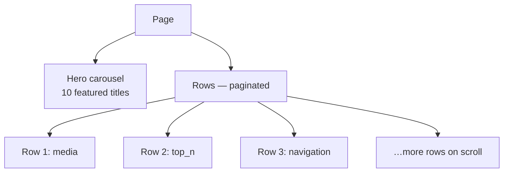

A **page** is the personalized browse screen your user sees after selecting a profile. It has two main parts: a **hero carousel** at the top (featured titles), and **recommendation rows** below (each row is a horizontal “rail” of media).

After your user selects a profile, you fetch a page with [`createPage()`](/sdk-reference/pages/create-page) and [`getPage()`](/sdk-reference/pages/get-page). Discovr fills the page's rows with personalized recommendations based on that profile's viewing history. Rows come in four types—**media** (movie/TV thumbnails), **top_n** (ranked lists), **navigation** (drill-down destinations), and **provider** (filter by streaming service). See [Rows overview](/guides/rows) for details and pagination.

<Note>
	Pages need an active profile. Start with
	[`selectProfile()`](/sdk-reference/authentication/select-profile) — covered in
	[Profiles](/guides/profiles) — then fetch pages. Code snippets use **TypeScript**, **Kotlin**, and
	**Swift** tabs.
</Note>

Illustrative UI only—hero from [`getPage()`](/sdk-reference/pages/get-page), stacked rails from [`getRows()`](/sdk-reference/rows/get-rows).

<Frame>
	
	
</Frame>



## Hero vs rows

- **[`getPage()`](/sdk-reference/pages/get-page)** returns the **page envelope**, including **`hero`** (the large carousel at the top—ten spotlight-style items).
- **[`getRows()`](/sdk-reference/rows/get-rows)** returns **rows** on that page, created on demand and paginated. Your UI stacks them vertically and scrolls; each row can be tapped for items or destinations as the row type implies.

Repeated [`createPage()`](/sdk-reference/pages/create-page) calls with the **same `pageFilters`** always return the **same page `id`**. The rows behind it stay put while your user browses and refresh roughly every 30 minutes.

<Check>
	Page ids are stable and permanent — the same filters always give the same id, for every profile
	and every device. Store them, route on them, put them in a deep link. Recommendations refresh
	roughly every 30 minutes and the id is unaffected; see [Recommendations](/guides/recommendations).
</Check>

## Typical “tabs”: Home, Movies, Series

Apps often expose top-level browsing as **tabs** or **modes**. Discovr does not ship tab UI—you map each tab to a **page created with filters**:

| Idea             | Approx. `createPage` body                       | Purpose               |
| ---------------- | ----------------------------------------------- | --------------------- |
| **Home** / mixed | `{}` — omit `pageFilters` or send empty filters | Broad, default browse |
| **Movies**       | `{ "pageFilters": { "media_type": "movie" } }`  | Movie-first rail mix  |
| **Series**       | `{ "pageFilters": { "media_type": "tv" } }`     | TV-first rail mix     |

Add an optional **`name`** (`"Movies"`, `"Series"`, etc.) when you store or debug tabs—responses can surface it depending on origin.

## Stack-like navigation from rows

Some **navigation-style rows** don’t stop at scrolling: choosing an item pushes the user onto **another page** (a **new `pageId`** and its own hero + rows). Treat that like a **navigation stack**: opening a drill-in **pushes** a page on your stack; system back **pops** it.

Drill-down is capped, so plan your browse tree around it — see
[Navigation](/guides/navigation) for the limit and how to design within it.

## Build the first surfaces

Use this flow once a profile is active ([`selectProfile()`](/sdk-reference/authentication/select-profile)).

<Steps>
	<Step title="Create pages for each top-level tab">
		Call [`createPage()`](/sdk-reference/pages/create-page) for Home (no filters), Movies (`media_type: "movie"`), and Series (`media_type: "tv"`). Persist each returned **`id`** for that tab.

    {/* sample: pages-build-the-first-surfaces */}

    <CodeGroup>

```typescript TypeScript
import { DiscovrClient } from "discovr";

const client = new DiscovrClient("your-client-id");

const home = await client.createPage({ name: "Home" });
const movies = await client.createPage({
	pageFilters: { mediaType: "movie" },
	name: "Movies",
});
const series = await client.createPage({
	pageFilters: { mediaType: "tv" },
	name: "Series",
});
```

```kotlin Kotlin
import api.discovr.DiscovrClient
import api.discovr.models.FilterSpec

suspend fun bootstrapPages(client: DiscovrClient) {
    val home = client.createPage(name = "Home")
    val movies = client.createPage(
        pageFilters = FilterSpec(mediaType = FilterSpec.MediaType.movie),
        name = "Movies"
    )
    val series = client.createPage(
        pageFilters = FilterSpec(mediaType = FilterSpec.MediaType.tv),
        name = "Series"
    )
    println("$home $movies $series")
}
```

```swift Swift
import Discovr

func bootstrapPages() async throws {
    let client = await DiscovrClient(clientId: "your-client-id")
    let home = try await client.createPage(name: "Home")
    let movies = try await client.createPage(
        pageFilters: FilterSpec(mediaType: .movie),
        name: "Movies"
    )
    let series = try await client.createPage(
        pageFilters: FilterSpec(mediaType: .tv),
        name: "Series"
    )
    print(home.id, movies.id, series.id)
}
```

    </CodeGroup>
    </Step>
    <Step title="Fetch hero metadata and rows">
    	Render the carousel from **`getPage(tabPageId)`** and list rails from **`getRows(tabPageId)`** (optionally **[`getRow()`](/sdk-reference/rows/get-row)** / **`getRowItems()`** once you drill into one row).

    {/* sample: pages-build-the-first-surfaces-2 */}

    <CodeGroup>

```typescript TypeScript
const page = await client.getPage(home.id);
const { rows, hasMore, nextPageToken } = await client.getRows(home.id, { limit: 10 });
console.log(page.hero.length, rows.length, hasMore, nextPageToken);
```

```kotlin Kotlin
suspend fun loadHomeRows(client: DiscovrClient, homeId: String) {
	val page = client.getPage(pageId = homeId)
	val bundle = client.getRows(pageId = homeId, limit = 10)
	println("${page.hero.size} ${bundle.rows.size} ${bundle.hasMore}")
}
```

```swift Swift
let page = try await client.getPage(pageId: home.id)
let bundle = try await client.getRows(pageId: home.id, limit: 10)
print(page.hero.count, bundle.rows.count, bundle.hasMore)
```

    </CodeGroup>
    </Step>
    <Step title="Handle push navigation from rows">
    	When a navigation item resolves to another destination, you usually receive a distinct **`pageId`**: **push** that screen and load it with the same layering—**`getPage`** for the hero, **`getRows`** (then [`getRow()`](/sdk-reference/rows/get-row) / **`getRowItems()`** when you open a rail). **Pop** back to the previous browse surface when the user navigates backward. See [Navigation](/guides/navigation) for how deep this can go.
    </Step>

</Steps>

## What’s next

- [Rows overview](/guides/rows) — row **`type`**, item shapes, and pagination with [`get-row`](/sdk-reference/rows/get-row) / [`get-row-items`](/sdk-reference/rows/get-row-items)
- [Media details](/guides/media) — open a title from hero or rails: **`getMedia`**, images, TV seasons/episodes, similar
- [Profile context](/guides/profile-context) — like/watchlist/playback, overlays, and scrobbling for the active profile
- [Recommendations](/guides/recommendations) — why page IDs never change, even when the rows behind them do
- [User UX: Navigation & Flows](/guides/navigation) — build tab-based and drill-down navigation with pages

## Related SDK reference

- [`createPage()`](/sdk-reference/pages/create-page) · [`getPage()`](/sdk-reference/pages/get-page)
- [`getRows()`](/sdk-reference/rows/get-rows) · [`getRow()`](/sdk-reference/rows/get-row) · [`getRowItems()`](/sdk-reference/rows/get-row-items)
- [`getMedia()`](/sdk-reference/media/get-media) · [Media details guide](/guides/media) · [Profile context](/guides/profile-context)

---

**Next:** [Rows — load content rails per row](/guides/rows)
