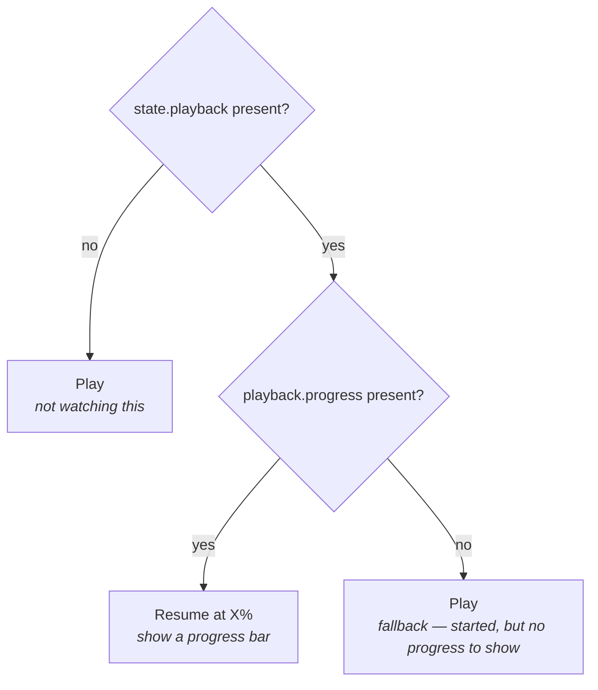

When you build a streaming app detail page, you pull catalog info (synopsis, images, release date) from **[`getMedia()`](/sdk-reference/media/get-media)**. But that's only half the story. You also need to know: _Has this user already watched it? Did they like it? Can they resume?_

That's what **[`getTitleState()`](/sdk-reference/profile-lists/get-title-state)** does. It returns a `TitleState` describing the viewer's relationship with a specific title—their rating, watchlist flag, how far they got, whether they've seen it before, and optionally where to watch it.

Think of it as **layering user state on top of catalog facts**. Your title sheet merges:

- **Catalog** (via `getMedia`) — synopsis, images, runtime, seasons
- **User state** (via `getTitleState`) — rating, watchlist status, resume position, watch progress, completion

Together, they tell you which button to show ("Resume from 45%", "Add to Watchlist", "Play") and what badges to highlight.

<Note>
	This endpoint requires an active profile session (start with
	[**`selectProfile()`**](/sdk-reference/authentication/select-profile)). Calling `getTitleState()`
	records that the viewer opened the title, so call it when the title screen opens — not on hover or
	prefetch. Code samples use **TypeScript / Kotlin / Swift**.
</Note>

<Note>
	**This call directly affects the profile's recommendations.** Calling `getTitleState()` records
	that the viewer opened the title, and it's the only call that does. Only call it when the title
	screen actually opens — never prefetch it or fire it on hover/focus. Ignoring this registers every
	loaded tile similarly to the viewer liking the show or movie, which will skew their
	recommendations. Pass the item's `ref` (see [passing the `ref` when your user
	acts](/guides/rows#pass-the-ref-when-your-user-acts)) so the open is credited to the row that
	offered it. Opening the same title again within half an hour counts once.
</Note>

## Five pieces of user state

**`getTitleState()`** gives you five signals about how the viewer relates to this title:

**Rating & watchlist** — `rating` is `"liked"`, `"disliked"`, `"super_liked"`, or `null`. `watchlist` is a boolean. Use these to show which buttons are active.

**Playback** — Show a “Resume from 45%” button. `playback` is either `null` (nothing in progress) or an object with `progress` (0–100%), `updatedAt`, and—for TV—`season` and `episode`.

**Watched** — Show a “Seen before” badge. `watched` turns `true` as soon as the viewer has played any of the title, even briefly, so it doesn't mean they finished it. For a “Watched” checkmark use `completed` below. `plays` counts completed plays.

**Completion** — Show a “Completed” checkmark or badge. `completed` is `true` once the viewer has finished the title: a movie counts as complete at 80% progress or more; a TV show counts as complete once every aired episode of every regular season is watched. For TV shows you also get `completedSeasons` and `episodes` (watched episode numbers per season). See [Completion rules](#completion-rules) below.

**Providers** — Pass `providers: true` and you also get where to watch: logos and links for the streaming services the viewer has picked on their Discovr account (the SDK can't change that selection). The list is empty when they haven't picked any. It costs an extra lookup, so ask for it only on screens that show it, like the title details screen. To list every service that carries the title, use `watchProviders` on [`getMedia()`](/sdk-reference/media/get-media) instead.

## How playback decides your button

Check whether `playback` is non-null:



For **TV shows**, `playback` also includes `season` and `episode` so you can show "Resume Season 2, Episode 5" instead of just a percentage. For **movies**, it's just a progress percentage.

<Tip>
	**Resume bars** trace **`playback`**; **“Seen before” badges** trace **`watched`**. They differ by
	design — a finished title has `watched: true` and `completed: true` while `playback` is `null`.
</Tip>

<Tip>
	A title can be on the watchlist and rated at the same time — ratings and watchlist are
	independent.
</Tip>

## Completion rules

Discovr applies one consistent rule for what counts as "finished," whether it's a movie, a season, or a whole show:

| Title type | Complete when...                                                  |
| ---------- | ----------------------------------------------------------------- |
| Movie      | Progress reaches 80% or more (or marked watched)                  |
| TV season  | Every aired episode in the season is watched (≥ 80% each)         |
| TV show    | Every regular season (season 1 and up) that has aired is complete |

**Specials (season 0) never count** toward a show's completion, and unaired episodes or seasons don't block completion either. If a new season starts airing later, `completed` automatically turns back to `false` until the viewer watches the new episodes.

For movies, `completed` is the only field you need — check it and show your badge.

For TV shows, `completed` tells you if the whole series is finished, `completedSeasons` tells you which seasons got there, and `episodes` lists the watched episode numbers per season. If you need a clean per-episode list for one season view, fetch [`getSeasonState()`](/guides/profile-context/season-profile-meta).

## Building your detail page

Fetching in parallel keeps your title sheet fast. When the user taps a title card:

1. Fetch **`getMedia()`** for catalog details (synopsis, images, seasons)
2. Fetch **`getTitleState()`** for user state (rating, watchlist, resume position, completion)
3. Merge them into your view model

Once loaded, your UI logic is straightforward:

- Show your primary button based on `state.playback` (Resume vs Play)
- Wire your rating and watchlist buttons to `state.rating` and `state.watchlist`
- Show a "Seen before" badge if `state.watched` is true
- Show a "Completed" badge if `state.completed` is true; for TV shows, use `state.completedSeasons` to mark finished seasons

**After user actions** — Every state write (`setRating`, `clearRating`, `addToWatchlist`, `removeFromWatchlist`, `markWatched`, `markUnwatched`) **returns the title's new `TitleState`**. Update your UI directly from that return value — there is no need to refetch `getTitleState()`, and avoiding redundant refetches keeps your open-click metrics accurate. For changes during playback, see [Tracking Playback with Scrobbling](/guides/profile-context/scrobbling).

**When switching profiles** — Call [`switchProfile()`](/sdk-reference/authentication/switch-profile), then call `getTitleState()` for the new profile. The catalog details can stay cached; only the per-viewer state changes.

## Example: Resume vs Play plus `liked`

The snippet shows **`state.playback`** gating **`Resume`** versus **`Play`**, alongside checking **`state.rating`**.

{/* sample: profile-context-media-profile-meta-example-resume-vs-play-plus-liked */}

<CodeGroup>

```typescript TypeScript
import type { TitleState } from "discovr";

function primaryCta(state: TitleState): { label: string; progress?: number } {
	if (state.playback) {
		return { label: "Resume", progress: state.playback.progress };
	}
	return { label: "Play" };
}

function liked(state: TitleState): boolean {
	return state.rating === "liked";
}
```

```kotlin Kotlin
import api.discovr.models.Rating
import api.discovr.models.TitleState

data class PrimaryCta(val label: String, val progress: Double? = null)

fun primaryCta(state: TitleState): PrimaryCta {
	val p = state.playback
	return if (p != null) {
		PrimaryCta(label = "Resume", progress = p.progress)
	} else {
		PrimaryCta(label = "Play")
	}
}

fun liked(state: TitleState): Boolean = state.rating == Rating.liked
```

```swift Swift
import Discovr

struct PrimaryCTA {
	var label: String
	var progress: Double?
}

func primaryCTA(from state: TitleState) -> PrimaryCTA {
	if let p = state.playback {
		return PrimaryCTA(label: "Resume", progress: p.progress)
	}
	return PrimaryCTA(label: "Play", progress: nil)
}

func liked(_ state: TitleState) -> Bool {
	state.rating == .liked
}
```

</CodeGroup>

## Related reading

- [Profile context](/guides/profile-context) — Overview of lists, ratings, playback, and syncing
- [Finished episodes with getSeasonState](/guides/profile-context/season-profile-meta) — Which episodes of a single season are finished
- [Tracking Playback with Scrobbling](/guides/profile-context/scrobbling) — How to keep watch history in sync as users watch
- [Media details](/guides/media) — Catalog info (`getMedia`)
- SDK Reference: [`getTitleState()`](/sdk-reference/profile-lists/get-title-state) · [`getMediaAssets()`](/sdk-reference/media/get-media-assets)

---

**Next:** [Finished episodes with getSeasonState](/guides/profile-context/season-profile-meta) — Which episodes of a TV season are finished
