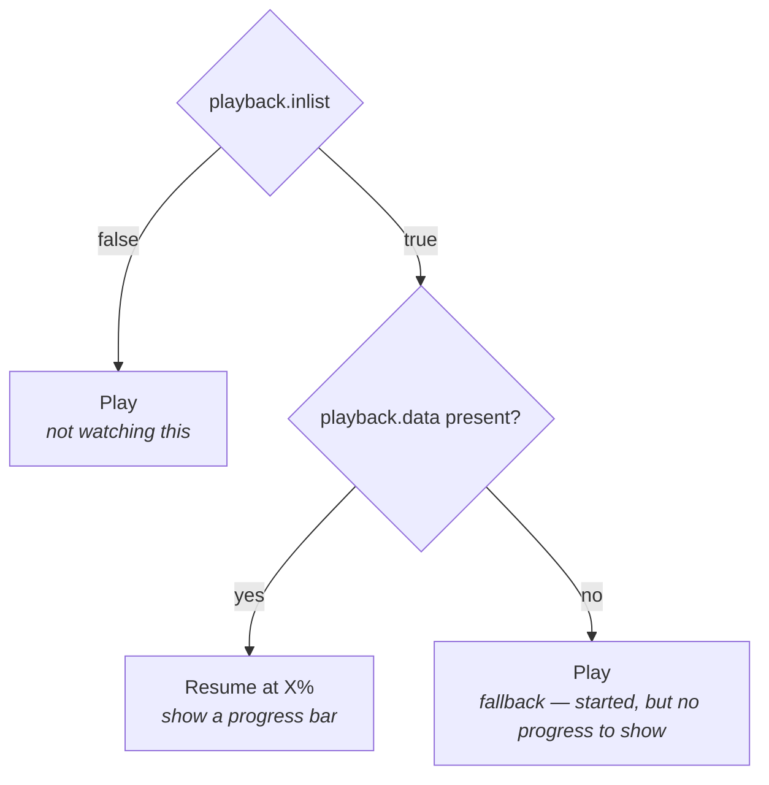

When you build a streaming app detail page, you pull catalog info (synopsis, images, release date) from **[`getMedia()`](/sdk-reference/media/get-media)**. But that's only half the story. You also need to know: _Has this user already watched it? Did they like it? Can they resume?_

That's what **`getMediaProfileMeta()`** does. It's the viewer's relationship with a specific title—what list it's on, how far they got, whether they've seen it before, and optionally where to watch it.

Think of it as **layering user state on top of catalog facts**. Your title sheet merges:

- **Catalog** (via `getMedia`) — synopsis, images, cast, runtime
- **User state** (via `getMediaProfileMeta`) — liked/watchlist status, resume position, watch history

Together, they tell you which button to show ("Resume from 45%", "Add to List", "Play") and what metadata to highlight.

<Note>
	This endpoint requires an active profile session (start with
	[**`selectProfile()`**](/sdk-reference/authentication/select-profile)). Which profile is asking is
	tracked for you, so you only pass the `mediaId`. Profile selection is covered in
	[Profiles](/guides/profiles). Code samples use **TypeScript / Kotlin / Swift**.
</Note>

## Five pieces of user state

**`getMediaProfileMeta()`** gives you five signals about how the viewer relates to this title:

**List membership** — Show a filled heart or thumbs up. `liked`, `disliked`, `super_liked`, `watchlist` are booleans — `true` means the user has added it to that list. Use these to show which buttons are “active”.

**Playback** — Show a “Resume from 45%” button. The `playback` object tells you whether the user is mid-watch and how far they got. For movies, it's a percentage (0–100%). For TV, you also get the season and episode.

**History** — Show a “Seen before” badge. A simple `true` or `false` that turns `true` as soon as the user has played any of the title, even briefly, so it doesn't mean they finished it. For a “Watched” checkmark use `completed` below. Don't use `history` as a substitute for playback position.

**Completion** — Show a “Completed” checkmark or badge. `completed` is `true` once the user has finished the title: a movie counts as complete at 80% progress or more; a TV show counts as complete once every one of its seasons is complete. For TV shows you also get `completedSeasons`, the list of season numbers the user has fully finished — handy for a season picker that checkmarks finished seasons. See [Completion rules](#completion-rules) below.

**Providers** — Pass `providers: true` and you also get where to watch: logos and links for the streaming services the viewer has picked on their Discovr account (the SDK can't change that selection). The list is empty when they haven't picked any. It costs an extra lookup on the backend, so ask for it only on the screens that show it, like the title details screen. To list every service that carries the title, use `watchProviders` on [`getMedia()`](/sdk-reference/media/get-media) instead; it's keyed by region.

## How playback decides your button

Check `inlist` first, then `data`. Two questions, three outcomes:



For **TV shows**, `data` also includes `season` and `episode` so you can show "Resume Season 2, Episode 5" instead of just a percentage. For **movies**, it's just a progress percentage.

**Pro tip:** Always check `inlist` before using `data`. A missing or stale `data` object with `inlist: true` is rare but possible—your fallback button should be "Play".

<Tip>
	**Resume bars** trace **`playback`**; **“Seen before” badges** trace **`history`**. They drift by
	design—for example something can sit in **`history`** while **`playback.inlist`** is false after
	removal or completion semantics.
</Tip>

<Tip>
	A title can be on the watchlist and the liked list at the same time — the API allows both. If your
	UI shows only one active state (heart vs. bookmark), enforce that in your app before writing.
</Tip>

## Completion rules

Discovr applies one consistent rule for what counts as "finished," whether it's a movie, a season, or a whole show:

| Title type | Complete when...                                     |
| ---------- | ---------------------------------------------------- |
| Movie      | Progress reaches 80% or more                         |
| TV season  | Every episode in the season is complete (≥ 80% each) |
| TV show    | Every season of the show is complete                 |

For movies, `completed` is the only field you need — check it and show your badge.

For TV shows, `completed` tells you if the whole series is finished, and `completedSeasons` tells you which seasons got there. If you're building a season picker, cross-reference `completedSeasons` against the season list from [`getMedia()`](/sdk-reference/media/get-media) to checkmark finished seasons. If you need per-episode detail within a season — which episodes are finished and which aren't — fetch [`getSeasonProfileMeta()`](/guides/profile-context/season-profile-meta) for that season.

<Tip>
	For a TV show, `completed` and `completedSeasons` are updated when the title's history changes (a
	scrobble, an added or edited history entry, a deletion, or `markUnwatched()`), not recalculated on
	every request. A movie's `completed` is read from its history each time. Either way, refetch
	`getMediaProfileMeta()` after playback or history changes to see the latest value, same as the
	other fields on this endpoint.
</Tip>

## Building your detail page

Fetching in parallel keeps your title sheet fast. When the user taps a title card:

1. Fetch **`getMedia()`** for catalog (synopsis, images, cast)
2. Fetch **`getMediaProfileMeta()`** for user state (resume position, lists)
3. Merge them into your view model

Once loaded, your UI logic is straightforward:

- Show your primary button based on `playback.inlist` and `playback.data` (Resume vs Play)
- Wire your like/dislike/watchlist buttons to the booleans
- Show a "Seen before" badge if `history` is true (they have played at least some of it)
- Show a "Completed" badge if `completed` is true; for TV shows, use `completedSeasons` to mark individual seasons

**After user actions** — If the user adds/removes from a list, or watches the content, fetch `getMediaProfileMeta()` again to keep your UI in sync. For changes during playback, see [Tracking Playback with Scrobbling](/guides/profile-context/scrobbling).

**When switching profiles** — Call [`switchProfile()`](/sdk-reference/authentication/switch-profile), then refetch `getMediaProfileMeta()`. The catalog details can stay cached; only the per-viewer state changes.

## Example: Resume vs Play plus `liked`

The snippet shows **`playback.inlist`** gating **`Resume`** versus **`Play`**, alongside a trivial **`liked`** read.

{/* sample: profile-context-media-profile-meta-example-resume-vs-play-plus-liked */}

<CodeGroup>

```typescript TypeScript
import type { MediaProfileMeta } from "discovr";

function primaryCta(meta: MediaProfileMeta): { label: string; progress?: number } {
	if (meta.playback.inlist && meta.playback.data) {
		const d = meta.playback.data;
		return { label: "Resume", progress: d.progress };
	}
	return { label: "Play" };
}

function liked(meta: MediaProfileMeta): boolean {
	return meta.liked;
}
```

```kotlin Kotlin
import api.discovr.models.MediaProfileMeta

data class PrimaryCta(val label: String, val progress: Double? = null)

fun primaryCta(meta: MediaProfileMeta): PrimaryCta {
	val d = meta.playback.data
	return if (meta.playback.inlist && d != null) {
		PrimaryCta(label = "Resume", progress = d.progress)
	} else {
		PrimaryCta(label = "Play")
	}
}

fun liked(meta: MediaProfileMeta): Boolean = meta.liked
```

```swift Swift
import Discovr

struct PrimaryCTA {
	var label: String
	var progress: Double?
}

func primaryCTA(from meta: MediaProfileMeta) -> PrimaryCTA {
	if meta.playback.inlist, let d = meta.playback.data {
		return PrimaryCTA(label: "Resume", progress: d.progress)
	}
	return PrimaryCTA(label: "Play", progress: nil)
}

func liked(_ meta: MediaProfileMeta) -> Bool {
	meta.liked
}
```

</CodeGroup>

## Related reading

- [Profile context](/guides/profile-context) — Overview of lists, playback, and syncing
- [Finished episodes with getSeasonProfileMeta](/guides/profile-context/season-profile-meta) — Which episodes of a single season are finished
- [Tracking Playback with Scrobbling](/guides/profile-context/scrobbling) — How to keep watch history in sync as users watch
- [Media details](/guides/media) — Catalog info (`getMedia`)
- API Reference: [`getMediaProfileMeta()`](/sdk-reference/media/get-media-profile-meta) · [`getMediaAssets()`](/sdk-reference/media/get-media-assets)

---

**Next:** [Finished episodes with getSeasonProfileMeta](/guides/profile-context/season-profile-meta) — Which episodes of a TV season are finished
