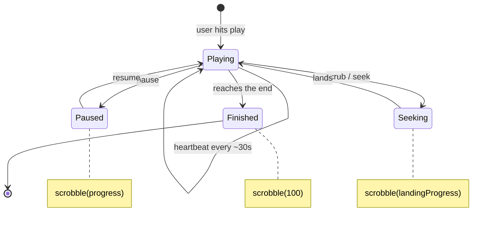

When someone watches a movie or episode, they pause, rewind, and scrub around. **Scrobbling** is how you tell Discovr about those moments—it's the everyday heartbeat that keeps watch history, completion, and resume position in sync.

Every time the user starts, pauses, seeks, or finishes watching, you send a **scrobble** with their current progress. Discovr uses that data to:

- Keep the Continue Watching row up-to-date with how far they got
- Automatically remove the title from the watchlist once progress reaches 20% (for both movies and TV shows)
- Mark the movie or episode complete once progress reaches 80% — and return `completedSeasons` when a TV episode crosses 80%. See [Completion rules](/guides/profile-context/media-profile-meta#completion-rules) for the full picture, or [`getSeasonState()`](/guides/profile-context/season-profile-meta) for per-episode detail within a season.

---

| Player event    | Call         | What to send                                            |
| --------------- | ------------ | ------------------------------------------------------- |
| Play starts     | `scrobble()` | The real start position (0–100 — not `0` when resuming) |
| Pause or resume | `scrobble()` | Current progress (0–100)                                |
| About every 30s | `scrobble()` | Current progress                                        |
| Seek or rewind  | `scrobble()` | The landing progress (0–100)                            |
| Playback ends   | `scrobble()` | `progress: 100`                                         |

<Note>
	Always send the viewer's **real** starting position when playback begins — if they resume a title
	at 45%, send `45`, not `0`. Lower progress moves the saved resume position (so rewinds work),
	while completion is never undone by playback — only [`markUnwatched()`](#undoing-a-watch) undoes
	completion.
</Note>

## Sending progress updates with `scrobble()`

Track progress as the user watches. Send the media ID (or `ref`) and current progress (0–100%).

{/* sample: profile-context-scrobbling-scrobble-progress-updates */}

<CodeGroup>

```typescript TypeScript
await client.scrobble(mediaId, progress);
```

```kotlin Kotlin
client.scrobble(mediaId, progress)
```

```swift Swift
try await client.scrobble(mediaId: mediaId, progress: progress)
```

</CodeGroup>

For TV, include the season and episode so progress lands on the right one:

{/* sample: profile-context-scrobbling-scrobble-progress-updates-2 */}

<CodeGroup>

```typescript TypeScript
await client.scrobble(mediaId, progress, {
	tv: { season: 1, episode: 5 },
});
```

```kotlin Kotlin
client.scrobble(mediaId, progress, tv = EpisodeRef(season = 1, episode = 5))
```

```swift Swift
try await client.scrobble(
    mediaId: mediaId,
    progress: progress,
    tv: EpisodeRef(season: 1, episode: 5)
)
```

</CodeGroup>

---

## When to call scrobble

Your player already knows all of these moments — scrobbling is a matter of hooking each one:



Call `scrobble()` at each of these points:

| Event          | Example                             | What to send                                 |
| -------------- | ----------------------------------- | -------------------------------------------- |
| **Start**      | Playback begins                     | Real starting `progress` (not `0` on resume) |
| **Pause**      | User pauses video                   | Current `progress`                           |
| **Resume**     | User un-pauses                      | Current `progress`                           |
| **Seek**       | User scrubs to new position         | New landing `progress`                       |
| **Completion** | Video finishes or reaches threshold | `progress: 100`                              |

**Don't spam.** A call every few hundred milliseconds only creates noise. Here's the rhythm to use:

- On start, pause, resume, seek, and completion: scrobble immediately.
- During playback: scrobble about every 30 seconds. That keeps "Continue Watching" within half a minute of where the viewer really is, which is as good as it needs to be.

---

## Example: A simple player heartbeat

Here's how you might wire a player to scrobble as the user watches:

{/* sample: profile-context-scrobbling-example-a-simple-player-heartbeat */}

<CodeGroup>

```typescript TypeScript
// When playback starts — send the real start position (not 0 when resuming)
async function onStart(mediaId: string, progress: number) {
	await client.scrobble(mediaId, progress);
}

// When the user pauses or seeks to a new position
async function onPauseOrSeek(mediaId: string, progress: number) {
	await client.scrobble(mediaId, progress);
}

// About every 30 seconds while playing
async function heartbeat(mediaId: string, progress: number) {
	await client.scrobble(mediaId, progress);
}
```

```kotlin Kotlin
// When playback starts — send the real start position (not 0 when resuming)
suspend fun onStart(mediaId: String, progress: Double) {
    client.scrobble(mediaId, progress)
}

// When the user pauses or seeks to a new position
suspend fun onPauseOrSeek(mediaId: String, progress: Double) {
    client.scrobble(mediaId, progress)
}

// About every 30 seconds while playing
suspend fun heartbeat(mediaId: String, progress: Double) {
    client.scrobble(mediaId, progress)
}
```

```swift Swift
// When playback starts — send the real start position (not 0 when resuming)
func onStart(mediaId: String, progress: Double) async throws {
    try await client.scrobble(mediaId: mediaId, progress: progress)
}

// When the user pauses or seeks to a new position
func onPauseOrSeek(mediaId: String, progress: Double) async throws {
    try await client.scrobble(mediaId: mediaId, progress: progress)
}

// About every 30 seconds while playing
func heartbeat(mediaId: String, progress: Double) async throws {
    try await client.scrobble(mediaId: mediaId, progress: progress)
}
```

</CodeGroup>

---

## Playback vs History

**Scrobble** is the everyday path during viewing. Every call updates where the viewer is in the title, which is what Continue Watching (`getPlaybackItems()`) and your resume button (`getTitleState().playback`) read.

Watch history (`getHistory()` / `getTitles({ watched: true })`) shows one entry per watched title, ordered most recently watched first. If you're migrating watch history from an external service, use [`importHistory()`](/sdk-reference/profile-lists/import-history) with an `imported` source name instead of `scrobble()`.

---

## Marking something as watched

Normal playback marks things watched on its own once progress reaches 80%. For a "Mark as watched" button (for viewers who saw something elsewhere), call **[`markWatched()`](/sdk-reference/scrobble/mark-watched)**.

One call marks a movie, an entire TV show (every aired episode across regular seasons — specials excluded), a single season, or a single episode atomically, clears any in-progress Continue Watching entry within that scope, and **returns the title's updated `TitleState`** so your UI updates without refetching `getTitleState()`.

{/* sample: scrobbling-mark-watched */}

<CodeGroup>

```typescript TypeScript
// A movie, or every aired episode of a show.
const state = await client.markWatched(mediaId);

// One season of a show.
await client.markWatched(mediaId, { season: 2 });

// One episode.
await client.markWatched(mediaId, { season: 2, episode: 5 });
```

```kotlin Kotlin
// A movie, or every aired episode of a show.
val state = client.markWatched(mediaId)

// One season of a show.
client.markWatched(mediaId, season = 2)

// One episode.
client.markWatched(mediaId, season = 2, episode = 5)
```

```swift Swift
// A movie, or every aired episode of a show.
let state = try await client.markWatched(mediaId: mediaId)

// One season of a show.
try await client.markWatched(mediaId: mediaId, season: 2)

// One episode.
try await client.markWatched(mediaId: mediaId, season: 2, episode: 5)
```

</CodeGroup>

---

## Undoing a watch

For a "Mark as unwatched" button, call **[`markUnwatched()`](/sdk-reference/scrobble/mark-unwatched)**. It clears the watched state for that scope, removes any matching Continue Watching position, and **returns the title's updated `TitleState`**, all in one call.

{/* sample: scrobbling-mark-unwatched */}

<CodeGroup>

```typescript TypeScript
// A movie, or every season of a show.
await client.markUnwatched(mediaId);

// One season of a show.
await client.markUnwatched(mediaId, { season: 2 });

// One episode.
await client.markUnwatched(mediaId, { season: 2, episode: 5 });
```

```kotlin Kotlin
// A movie, or every season of a show.
client.markUnwatched(mediaId)

// One season of a show.
client.markUnwatched(mediaId, season = 2)

// One episode.
client.markUnwatched(mediaId, season = 2, episode = 5)
```

```swift Swift
// A movie, or every season of a show.
try await client.markUnwatched(mediaId: mediaId)

// One season of a show.
try await client.markUnwatched(mediaId: mediaId, season: 2)

// One episode.
try await client.markUnwatched(mediaId: mediaId, season: 2, episode: 5)
```

</CodeGroup>

For a TV show, `season` and `episode` choose how much to undo: neither clears the whole show, a season clears that season, and a season with an episode clears just that episode. Calling it for something that isn't watched changes nothing and still succeeds, so it is safe to retry. Update your UI straight from the returned `TitleState`.

<Warning>
	Don't try to undo a watch by calling `scrobble(0)` — scrobbling moves the live position without
	undoing completion. Use `markUnwatched()` so watched state, completion, and Continue Watching stay
	consistent.
</Warning>

---

## Related reading

- [Profile context](/guides/profile-context) — overview of lists, ratings, playback, and history
- [Understanding Your Media State](/guides/profile-context/media-profile-meta) — how `getTitleState` reflects scrobble and mark updates
- [`scrobble()` SDK Reference](/sdk-reference/scrobble/scrobble) — completion thresholds and watchlist side effects
- [`markWatched()` SDK Reference](/sdk-reference/scrobble/mark-watched) · [`markUnwatched()` SDK Reference](/sdk-reference/scrobble/mark-unwatched)

---

**Next:** [Navigation flows](/guides/navigation)
