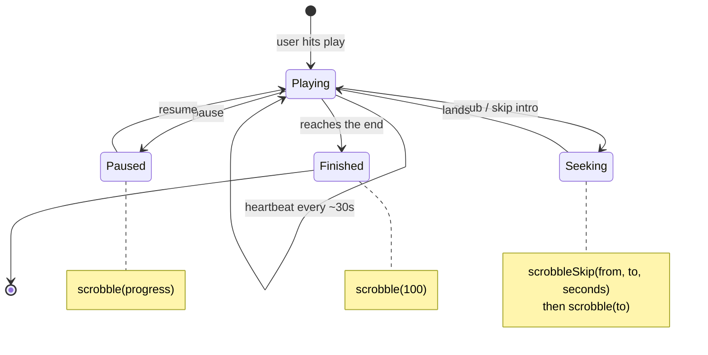

When someone watches a movie or episode, they pause, rewind, and skip around. **Scrobbling** is how you tell Discovr about those moments—it's the everyday heartbeat that keeps watch history and resume position in sync.

Every time the user pauses, seeks, or finishes watching, you send a **scrobble** with their progress. Discovr uses that data to:

- Keep the Continue Watching row up-to-date with how far they got
- Track what they've watched for the history log
- Update completion state — a movie or episode counts as complete once progress reaches 80%; a season completes when every episode in it is complete; a show completes when every season is complete. See [`getMediaProfileMeta`'s completion rules](/guides/profile-context/media-profile-meta#completion-rules) for the full picture, or [`getSeasonProfileMeta`](/guides/profile-context/season-profile-meta) for per-episode detail within a season.

---

| Player event    | Call                           | What to send                                                                   |
| --------------- | ------------------------------ | ------------------------------------------------------------------------------ |
| Play starts     | `scrobble()`                   | `progress: 0`                                                                  |
| Pause or resume | `scrobble()`                   | Current progress (0–100)                                                       |
| About every 30s | `scrobble()`                   | Current progress                                                               |
| Seek or skip    | `scrobbleSkip()`, `scrobble()` | Where it started and landed (0–100), seconds jumped, then the landing progress |
| Playback ends   | `scrobble()`                   | `progress: 100`                                                                |

## The two scrobbling calls

### `scrobble()` — progress updates

Track progress as the user watches. Send the media ID and current progress (0–100%).

{/* sample: profile-context-scrobbling-scrobble-progress-updates */}

<CodeGroup>

```typescript TypeScript
await client.scrobble(mediaId, progress);
```

```kotlin Kotlin
client.scrobble(mediaId, progress)
```

```swift Swift
try await client.scrobble(mediaId: mediaId, progress: progress)
```

</CodeGroup>

For TV, include the season and episode so progress lands on the right one:

{/* sample: profile-context-scrobbling-scrobble-progress-updates-2 */}

<CodeGroup>

```typescript TypeScript
await client.scrobble(mediaId, progress, {
	tv: { season: 1, episode: 5 },
});
```

```kotlin Kotlin
client.scrobble(mediaId, progress, tv = ScrobbleTv(season = 1, episode = 5))
```

```swift Swift
try await client.scrobble(
    mediaId: mediaId,
    progress: progress,
    tv: ScrobbleTv(season: 1, episode: 5)
)
```

</CodeGroup>

### `scrobbleSkip()` — recording skips

When the user jumps around (fast-forward, rewind, skip intro), log it. Send the progress (0–100) where the skip started and where it landed, and how many seconds it jumped, whichever way. This helps us understand viewing patterns, like where people skip an intro or go back to catch a line they missed.

A jump backward counts too: send the rewind with `from` higher than `to`. The only thing it rejects is a jump that doesn't move (`from` equal to `to`).

{/* sample: profile-context-scrobbling-scrobbleskip-recording-skips */}

<CodeGroup>

```typescript TypeScript
await client.scrobbleSkip(mediaId, from, to, secondsSkipped);
```

```kotlin Kotlin
client.scrobbleSkip(mediaId, from, to, secondsSkipped)
```

```swift Swift
try await client.scrobbleSkip(mediaId: mediaId, from: from, to: to, duration: secondsSkipped)
```

</CodeGroup>

---

## When to call scrobble

Your player already knows all of these moments — scrobbling is a matter of hooking each one:



Call `scrobble()` at each of these points:

| Event          | Example                             | What to send       |
| -------------- | ----------------------------------- | ------------------ |
| **Pause**      | User pauses video                   | Current `progress` |
| **Resume**     | User un-pauses                      | Current `progress` |
| **Seek**       | User scrubs to new position         | New `progress`     |
| **Completion** | Video finishes or reaches threshold | `progress: 100`    |

**Don't spam.** Every scrobble updates the resume position, the history and the watchlist, so a call every few hundred milliseconds only creates noise. Here's the rhythm to use:

- On pause, resume, seek and completion: scrobble immediately.
- During playback: scrobble about every 30 seconds. That keeps "Continue Watching" within half a minute of where the viewer really is, which is as good as it needs to be.

---

## Example: A simple player heartbeat

Here's how you might wire a player to scrobble as the user watches:

{/* sample: profile-context-scrobbling-example-a-simple-player-heartbeat */}

<CodeGroup>

```typescript TypeScript
// When the user pauses
async function onPause(mediaId: string, progress: number) {
	await client.scrobble(mediaId, progress);
}

// When they skip or rewind — log the jump, then the position they landed on
async function onSkip(mediaId: string, from: number, toProgress: number, secondsSkipped: number) {
	await client.scrobbleSkip(mediaId, from, toProgress, secondsSkipped);
	await client.scrobble(mediaId, toProgress);
}

// About every 30 seconds while playing
async function heartbeat(mediaId: string, progress: number) {
	await client.scrobble(mediaId, progress);
}
```

```kotlin Kotlin
// When the user pauses
suspend fun onPause(mediaId: String, progress: Double) {
    client.scrobble(mediaId, progress)
}

// When they skip or rewind — log the jump, then the position they landed on
suspend fun onSkip(mediaId: String, from: Double, toProgress: Double, secondsSkipped: Double) {
    client.scrobbleSkip(mediaId, from, toProgress, secondsSkipped)
    client.scrobble(mediaId, toProgress)
}

// About every 30 seconds while playing
suspend fun heartbeat(mediaId: String, progress: Double) {
    client.scrobble(mediaId, progress)
}
```

```swift Swift
// When the user pauses
func onPause(mediaId: String, progress: Double) async throws {
    try await client.scrobble(mediaId: mediaId, progress: progress)
}

// When they skip or rewind — log the jump, then the position they landed on
func onSkip(mediaId: String, from: Double, toProgress: Double, secondsSkipped: Double) async throws {
    try await client.scrobbleSkip(mediaId: mediaId, from: from, to: toProgress, duration: secondsSkipped)
    try await client.scrobble(mediaId: mediaId, progress: toProgress)
}

// About every 30 seconds while playing
func heartbeat(mediaId: String, progress: Double) async throws {
    try await client.scrobble(mediaId: mediaId, progress: progress)
}
```

</CodeGroup>

---

## About skip data

At the moment `scrobbleSkip()` has no effect on the user's data, but we're hoping to use the data for automatic detection of intros and outros so Discovr can help make "Skip Intro" buttons in the future. If your player supports skip detection, please send it via `scrobbleSkip()`.

---

## Playback vs History

**Scrobble** is the everyday path during viewing. Every call updates where the viewer is in the title, which is what Continue Watching and your resume button read. History is written less often: when a title is started, and when it's finished. So a scrobble every 30 seconds never adds up to hundreds of history entries, and history's `progress` is not a live resume position.

If you need to **correct or backfill** history (e.g., adjusting completion metadata), use the **history APIs** instead. See [Profile context](/guides/profile-context) for the distinction between playback (resume queue) and history (event log).

---

## Marking something as watched

Normal playback marks things watched on its own: once progress reaches 80%, the title is **complete** (`completed: true` on [`getMediaProfileMeta()`](/guides/profile-context/media-profile-meta)) and leaves Continue Watching. "Watched" and "complete" are the same thing here. So you only need a button for viewers who saw something somewhere else.

For that button, scrobble `100`. Any progress of 80 or more would complete it, and `100` also records it as fully watched, which is what your player sends when playback ends. The title leaves Continue Watching and comes off the watchlist, just as it would after watching it through.

Don't confuse this with the `history` flag, which is `true` as soon as the viewer has played any of the title, even for a few seconds. Use `completed` for a "Watched" checkmark.

{/* sample: scrobbling-mark-watched */}

<CodeGroup>

```typescript TypeScript
// A movie.
await client.scrobble(mediaId, 100);

// One episode of a show.
await client.scrobble(mediaId, 100, { tv: { season: 2, episode: 5 } });
```

```kotlin Kotlin
// A movie.
client.scrobble(mediaId, 100.0)

// One episode of a show.
client.scrobble(mediaId, 100.0, tv = ScrobbleTv(season = 2, episode = 5))
```

```swift Swift
// A movie.
try await client.scrobble(mediaId: mediaId, progress: 100)

// One episode of a show.
try await client.scrobble(
    mediaId: mediaId,
    progress: 100,
    tv: ScrobbleTv(season: 2, episode: 5)
)
```

</CodeGroup>

It works on one movie or one episode at a time. There's no single call that marks a whole season or show, so for those, scrobble each episode. To go the other way, see [Undoing a watch](#undoing-a-watch).

---

## Undoing a watch

For a "Mark as unwatched" button, call [`markUnwatched()`](/sdk-reference/scrobble/mark-unwatched). It removes the history that made the title watched, takes it out of Continue Watching if that is where it was, and brings a TV show's `completed` state back in line, all in one call.

{/* sample: scrobbling-mark-unwatched */}

<CodeGroup>

```typescript TypeScript
// A movie, or every season of a show.
await client.markUnwatched(mediaId);

// One season of a show.
await client.markUnwatched(mediaId, { season: 2 });

// One episode.
await client.markUnwatched(mediaId, { season: 2, episode: 5 });
```

```kotlin Kotlin
// A movie, or every season of a show.
client.markUnwatched(mediaId)

// One season of a show.
client.markUnwatched(mediaId, season = 2)

// One episode.
client.markUnwatched(mediaId, season = 2, episode = 5)
```

```swift Swift
// A movie, or every season of a show.
try await client.markUnwatched(mediaId: mediaId)

// One season of a show.
try await client.markUnwatched(mediaId: mediaId, season: 2)

// One episode.
try await client.markUnwatched(mediaId: mediaId, season: 2, episode: 5)
```

</CodeGroup>

For a TV show, `season` and `episode` choose how much to undo: neither clears the whole show, a season clears that season, and a season with an episode clears just that episode. Calling it for something that isn't watched changes nothing and still succeeds, so it is safe to retry. Refetch [`getMediaProfileMeta()`](/guides/profile-context/media-profile-meta) afterwards to refresh your badges.

<Warning>
	Don't build this out of `scrobble(0)`, `deleteHistoryItem()` and `deletePlaybackItem()`.
	`scrobble()` records a new history entry even at 0%, so scrobbling after deleting leaves the title
	marked as seen, and `deleteHistoryItem()` on its own removes entries only for the season or
	episode you name. `markUnwatched()` takes care of the order and the scope for you.
</Warning>

---

## Related reading

- [Profile context](/guides/profile-context) — overview of lists, playback, and history
- [Understanding Your Media State](/guides/profile-context/media-profile-meta) — how `getMediaProfileMeta` reflects scrobble updates
- [`scrobble()` SDK Reference](/sdk-reference/scrobble/scrobble) — completion thresholds and watchlist side effects
- [`scrobbleSkip()` SDK Reference](/sdk-reference/scrobble/scrobble-skip) — skip telemetry details

---

**Next:** [Navigation flows](/guides/navigation)
