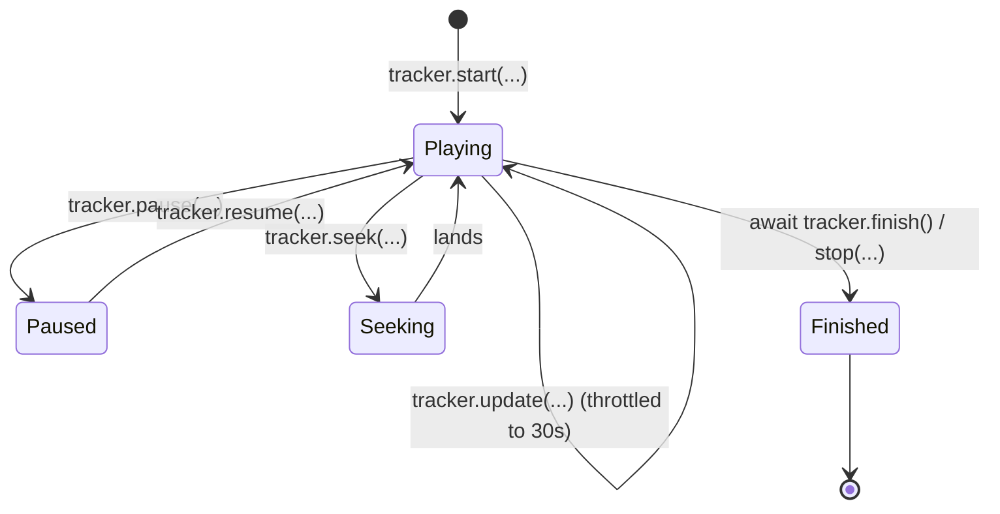

When someone watches a movie or episode, they pause, rewind, and scrub around. **Scrobbling** is how you tell Discovr about those moments—it keeps watch history, completion, and resume position in sync across devices.

Use **`client.trackPlayback(item)`** to create a `PlaybackTracker` for each movie or episode you play. Report player lifecycle events as they happen, and the tracker handles the 30-second heartbeat throttle, strict serial ordering, episode handoff, pause/resume deduplication, and backoff on rate limits for you.

Discovr uses those updates to:

- Keep the Continue Watching row up to date with how far the viewer got
- Automatically remove the title from the watchlist once progress reaches 20% (for both movies and TV shows)
- Mark the movie or episode complete once progress reaches 80% — and return `completedSeasons` when a TV episode crosses 80%. See [Completion rules](/guides/profile-context/media-profile-meta#completion-rules) for the full picture, or [`getSeasonState()`](/guides/profile-context/season-profile-meta) for per-episode detail within a season.

---

| Player event      | Call on `PlaybackTracker`            | What it does                                                            |
| ----------------- | ------------------------------------ | ----------------------------------------------------------------------- |
| Play starts       | `tracker.start(...)`                 | Sends immediately with the real start position (not `0` on resume)      |
| Periodic tick     | `tracker.update(...)`                | Safe to call every second — throttled to every 30s automatically        |
| Pause / resume    | `tracker.pause(...)` / `resume(...)` | Sends immediately; repeat pause/resume calls are deduplicated           |
| Seek or rewind    | `tracker.seek(...)`                  | Sends immediately and resets the 30-second heartbeat timer              |
| Stop early        | `await tracker.stop(...)`            | Once-only terminal send; awaits delivery and returns `ScrobbleResponse` |
| Played to the end | `await tracker.finish()`             | Once-only terminal send at `100%`; returns `ScrobbleResponse`           |

<Note>
	Always pass the viewer's **real** starting position when playback begins — if they resume a title
	at 45%, call `tracker.start(45)`, not `0`. Lower progress moves the saved resume position (so
	rewinds work), while completion is never undone by playback — only
	[`markUnwatched()`](#undoing-a-watch) undoes completion.
</Note>

## Track playback with `client.trackPlayback()`

Create one `PlaybackTracker` per movie or episode by passing the item directly (so its `ref` is preserved automatically; a raw `mediaId` works too). Percentage (`0–100`) is the primary unit everywhere:

{/* sample: profile-context-scrobbling-scrobble-progress-updates */}

<CodeGroup>

```typescript TypeScript
const tracker = client.trackPlayback(item);

// Send the real starting position (e.g. 45 when resuming, never 0 on resume).
tracker.start(0);

// Safe to call every second while playing — throttled to 30s automatically.
tracker.update(32.5);

// Pause, resume, and seek send immediately and deduplicate repeat events.
tracker.pause(42.0);
tracker.resume(42.0);
tracker.seek(60.0);

// Terminal call: once-only, awaits delivery, and returns the ScrobbleResponse.
const result = await tracker.stop(64.0); // or await tracker.finish() at 100%
```

```kotlin Kotlin
val tracker = client.trackPlayback(item)

// Send the real starting position (e.g. 45.0 when resuming, never 0.0 on resume).
tracker.start(0.0)

// Safe to call every second while playing — throttled to 30s automatically.
tracker.update(32.5)

// Pause, resume, and seek send immediately and deduplicate repeat events.
tracker.pause(42.0)
tracker.resume(42.0)
tracker.seek(60.0)

// Terminal call: once-only, awaits delivery, and returns the ScrobbleResponse.
val result = tracker.stop(64.0) // or tracker.finish() at 100%
```

```swift Swift
let tracker = client.trackPlayback(item)

// Send the real starting position (e.g. 45 when resuming, never 0 on resume).
tracker.start(progress: 0)

// Safe to call every second while playing — throttled to 30s automatically.
tracker.update(progress: 32.5)

// Pause, resume, and seek send immediately and deduplicate repeat events.
tracker.pause(progress: 42.0)
tracker.resume(progress: 42.0)
tracker.seek(progress: 60.0)

// Terminal call: once-only, awaits delivery, and returns the ScrobbleResponse.
let result = await tracker.stop(progress: 64.0) // or await tracker.finish() at 100%
```

</CodeGroup>

Both `stop()` and `finish()` are **once-only** and idempotent: if your player fires both an ended event and a teardown hook, only the first call sends a network request, and both calls resolve to the same `ScrobbleResponse`.

### TV episodes and autoplay handoff

For TV shows, pass `tv` with the season and episode (if you pass a `PlaybackItem` from Continue Watching, `tv` is filled in automatically). When auto-advancing to the next episode, pass the previous tracker in **`after`** so episode 5's `finish()` lands before episode 6's `start()` is sent:

{/* sample: profile-context-scrobbling-scrobble-progress-updates-2 */}

<CodeGroup>

```typescript TypeScript
const ep5 = client.trackPlayback(item, {
	tv: { season: 1, episode: 5 },
	onCompleted: (res) => console.log("Completed seasons:", res.completedSeasons),
});
ep5.start(0);
await ep5.finish();

// Next-episode autoplay: wait for ep5's final scrobble before ep6's start lands.
const ep6 = client.trackPlayback(item, {
	tv: { season: 1, episode: 6 },
	after: ep5,
});
ep6.start(0);
```

```kotlin Kotlin
val ep5 = client.trackPlayback(
    item,
    tv = EpisodeRef(season = 1, episode = 5),
    onCompleted = { res -> println("Completed seasons: ${res.completedSeasons}") },
)
ep5.start(0.0)
ep5.finish()

// Next-episode autoplay: wait for ep5's final scrobble before ep6's start lands.
val ep6 = client.trackPlayback(
    item,
    tv = EpisodeRef(season = 1, episode = 6),
    after = ep5,
)
ep6.start(0.0)
```

```swift Swift
let ep5 = client.trackPlayback(
    item,
    tv: EpisodeRef(season: 1, episode: 5),
    onCompleted: { res in print("Completed seasons:", res.completedSeasons ?? []) }
)
ep5.start(progress: 0)
await ep5.finish()

// Next-episode autoplay: wait for ep5's final scrobble before ep6's start lands.
let ep6 = client.trackPlayback(
    item,
    tv: EpisodeRef(season: 1, episode: 6),
    after: ep5
)
ep6.start(progress: 0)
```

</CodeGroup>

Use `onCompleted` to react once when a movie or episode first crosses the 80% completion threshold (for example, to refresh a season checkmark or badge), and `onError` to log or observe failures without throwing into your player loop.

---

## Wiring a player with `(position, duration)`

If your player reports current time and duration instead of a percentage, pass both on each call. The tracker computes the percentage per call and never caches a fixed duration across calls (so streams that switch quality or source stay accurate). Calls with `duration <= 0` or non-finite values are safely ignored instead of overwriting resume position with `0%`.



{/* sample: profile-context-scrobbling-example-a-simple-player-heartbeat */}

<CodeGroup>

```typescript TypeScript
const tracker = client.trackPlayback(item, {
	onError: (err) => console.warn("Scrobble failed:", err),
});

// Pass the current stream's { position, duration } in any matching unit (seconds or ms).
// Calls with duration <= 0 are ignored instead of overwriting resume position with 0%.
function onPlay(position: number, duration: number) {
	tracker.start({ position, duration });
}
function onTimeUpdate(position: number, duration: number) {
	tracker.update({ position, duration }); // throttled to every 30s
}
function onPause(position: number, duration: number) {
	tracker.pause({ position, duration });
}
function onSeek(position: number, duration: number) {
	tracker.seek({ position, duration });
}
async function onStop(position: number, duration: number) {
	await tracker.stop({ position, duration });
}
```

```kotlin Kotlin
val tracker = client.trackPlayback(
    item,
    onError = { err -> println("Scrobble failed: $err") },
)

// Pass the current stream's (position, duration) in any matching unit (seconds or ms).
// Calls with duration <= 0 are ignored instead of overwriting resume position with 0%.
fun onPlay(position: Double, duration: Double) = tracker.start(position, duration)
fun onTimeUpdate(position: Double, duration: Double) = tracker.update(position, duration) // throttled to every 30s
fun onPause(position: Double, duration: Double) = tracker.pause(position, duration)
fun onSeek(position: Double, duration: Double) = tracker.seek(position, duration)
suspend fun onStop(position: Double, duration: Double) = tracker.stop(position, duration)
```

```swift Swift
let tracker = client.trackPlayback(
    item,
    onError: { err in print("Scrobble failed:", err) }
)

// Pass the current stream's (position, duration) in any matching unit (seconds or ms).
// Calls with duration <= 0 are ignored instead of overwriting resume position with 0%.
func onPlay(position: Double, duration: Double) {
    tracker.start(position: position, duration: duration)
}
func onTimeUpdate(position: Double, duration: Double) {
    tracker.update(position: position, duration: duration) // throttled to every 30s
}
func onPause(position: Double, duration: Double) {
    tracker.pause(position: position, duration: duration)
}
func onSeek(position: Double, duration: Double) {
    tracker.seek(position: position, duration: duration)
}
func onStop(position: Double, duration: Double) async {
    await tracker.stop(position: position, duration: duration)
}
```

</CodeGroup>

<Tip>
	**Low-level escape hatch:** If you are reporting playback from a backend service or already own a
	serial scrobble queue and 30-second throttle, you can still call
	[`client.scrobble()`](/sdk-reference/scrobble/scrobble) directly. For player integrations in an
	app, prefer `client.trackPlayback(item)`.
</Tip>

---

## `trackPlayback` vs `markWatched` vs `importHistory`

Choose the right call for where the watch came from:

| Scenario                                              | What to call                                                                                                          |
| ----------------------------------------------------- | --------------------------------------------------------------------------------------------------------------------- |
| Live playback in your player                          | `client.trackPlayback(item)` (or low-level [`scrobble()`](/sdk-reference/scrobble/scrobble))                          |
| Manual "Mark as watched" / "Mark as unwatched" button | [`markWatched()`](/sdk-reference/scrobble/mark-watched) / [`markUnwatched()`](/sdk-reference/scrobble/mark-unwatched) |
| Backfilling watch history from an external service    | [`importHistory()`](/sdk-reference/profile-lists/import-history) with an `imported` source label                      |

Watch history (`getHistory()` / `getTitles({ watched: true })`) returns one entry per watched title, ordered most recently watched first. Continue Watching (`getPlaybackItems()`) holds the viewer's live resume position.

---

## Marking something as watched

Normal playback marks things watched on its own once progress reaches 80%. For a "Mark as watched" button (for viewers who saw something elsewhere), call **[`markWatched()`](/sdk-reference/scrobble/mark-watched)**.

One call marks a movie, an entire TV show (every aired episode across regular seasons — specials excluded), a single season, or a single episode atomically, clears any in-progress Continue Watching entry within that scope, and **returns the title's updated `TitleState`** so your UI updates without refetching `getTitleState()`.

{/* sample: scrobbling-mark-watched */}

<CodeGroup>

```typescript TypeScript
// A movie, or every aired episode of a show.
const state = await client.markWatched(item);

// One season of a show.
await client.markWatched(item, { season: 2 });

// One episode.
await client.markWatched(item, { season: 2, episode: 5 });
```

```kotlin Kotlin
// A movie, or every aired episode of a show.
val state = client.markWatched(item)

// One season of a show.
client.markWatched(item, season = 2)

// One episode.
client.markWatched(item, season = 2, episode = 5)
```

```swift Swift
// A movie, or every aired episode of a show.
let state = try await client.markWatched(item)

// One season of a show.
try await client.markWatched(item, season: 2)

// One episode.
try await client.markWatched(item, season: 2, episode: 5)
```

</CodeGroup>

---

## Undoing a watch

For a "Mark as unwatched" button, call **[`markUnwatched()`](/sdk-reference/scrobble/mark-unwatched)**. It clears the watched state for that scope, removes any matching Continue Watching position, and **returns the title's updated `TitleState`**, all in one call.

{/* sample: scrobbling-mark-unwatched */}

<CodeGroup>

```typescript TypeScript
// A movie, or every season of a show.
const state = await client.markUnwatched(item);

// One season of a show.
await client.markUnwatched(item, { season: 2 });

// One episode.
await client.markUnwatched(item, { season: 2, episode: 5 });
```

```kotlin Kotlin
// A movie, or every season of a show.
val state = client.markUnwatched(item)

// One season of a show.
client.markUnwatched(item, season = 2)

// One episode.
client.markUnwatched(item, season = 2, episode = 5)
```

```swift Swift
// A movie, or every season of a show.
let state = try await client.markUnwatched(item)

// One season of a show.
try await client.markUnwatched(item, season: 2)

// One episode.
try await client.markUnwatched(item, season: 2, episode: 5)
```

</CodeGroup>

For a TV show, `season` and `episode` choose how much to undo: neither clears the whole show, a season clears that season, and a season with an episode clears just that episode. Calling it for something that isn't watched changes nothing and still succeeds, so it is safe to retry. Update your UI straight from the returned `TitleState`.

<Warning>
	Don't try to undo a watch by calling `scrobble(0)` — scrobbling moves the live position without
	undoing completion. Use `markUnwatched()` so watched state, completion, and Continue Watching stay
	consistent.
</Warning>

---

## Related reading

- [Profile context](/guides/profile-context) — overview of lists, ratings, playback, and history
- [Understanding Your Media State](/guides/profile-context/media-profile-meta) — how `getTitleState` reflects scrobble and mark updates
- [`scrobble()` SDK Reference](/sdk-reference/scrobble/scrobble) — completion thresholds and watchlist side effects
- [`markWatched()` SDK Reference](/sdk-reference/scrobble/mark-watched) · [`markUnwatched()` SDK Reference](/sdk-reference/scrobble/mark-unwatched)

---

**Next:** [Navigation flows](/guides/navigation)
