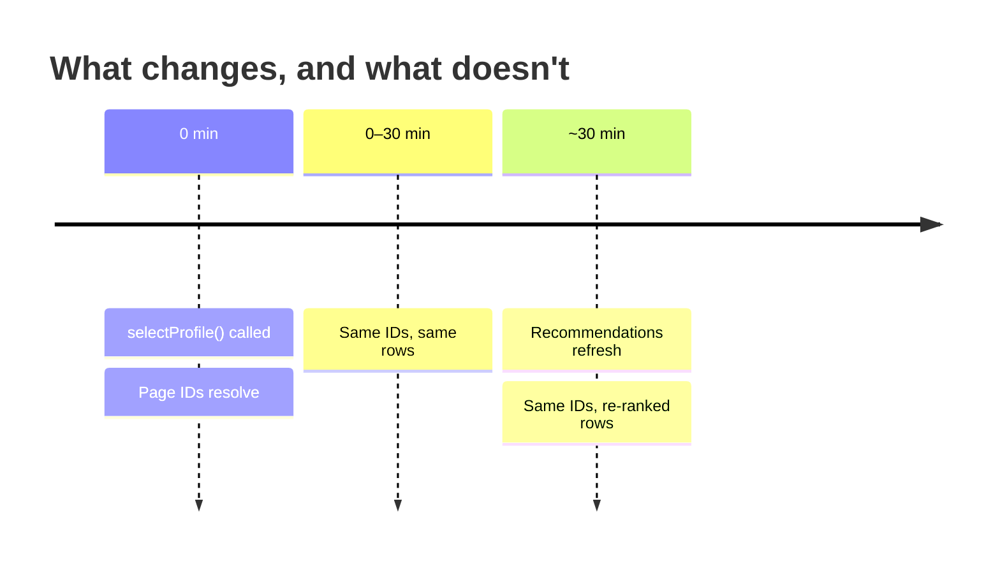

You've built a browse screen. Now for the thing that makes it feel alive: the rows behind it change on their own, roughly every 30 minutes, so a user who opens your app after lunch doesn't see exactly what they saw at breakfast.

The important part is what _doesn't_ change. **A page ID is permanent.** When recommendations turn over, the same page ID comes back with re-ranked rows — so there's never anything to swap, migrate, or invalidate on your side.

## Page IDs are stable

A page's ID comes from its filters — nothing else. The same filters return the same ID for every profile, on every device, indefinitely.

<Check>
	Put page IDs in URLs. Bookmark them. Store them in a navigation stack. Send them in a deep link
	that opens next week. They keep working.
</Check>



Row IDs are stable in a subtler but equally useful way: they keep resolving after a refresh, so a user part-way through a rail can finish scrolling it.

## Knowing when they turned over

Subscribe once after sign-in. [`onRecommendationsChanged`](/sdk-reference/authentication/on-recommendations-changed) fires only on a real turnover, so every call is worth acting on.

{/* sample: recommendations-knowing-when-they-turned-over */}

<CodeGroup>

```typescript TypeScript
client.onRecommendationsChanged(() => {
	// Same page ID — only the rows behind it moved. Flag it and reload on the
	// user's next navigation — not mid-scroll. See "Applying a turnover" below.
	markRecommendationsStale();
});
```

```kotlin Kotlin
lifecycleScope.launch {
    client.recommendationChanges.collect {
        markRecommendationsStale()
    }
}
```

```swift Swift
Task {
    for await _ in await client.recommendationChangeStream {
        markRecommendationsStale()
    }
}
```

</CodeGroup>

<Note>
	It doesn't fire when you subscribe — it reports an event, not a state. A fresh subscriber won't be
	told to refetch a page it has only just loaded.
</Note>

<Tip>
	One consequence worth designing around: a screen that mounts *after* a turnover hears nothing
	until the next one, so it can render rows fetched before the change. If that matters — a
	long-lived tab, a screen restored from the background — subscribe once at app start rather than
	per screen, and fetch fresh on mount. Unlike this event,
	[`onSessionRefreshed`](/sdk-reference/authentication/on-session-refreshed) *does* deliver the
	current `snapshotId` on subscribe, so you can compare it against the one your data came from.
</Tip>

## Applying a turnover

Refetching is just calling [`getPage()`](/sdk-reference/pages/get-page) and
[`getRows()`](/sdk-reference/rows/get-rows) again with the same page ID and rendering the result —
there's nothing to recreate.

**When** you do it is the part worth getting right. Don't swap the rows out the instant the event
fires: a user reading row 12 doesn't want the screen to jump. Instead:

- **Fold it into their next navigation.** Mark the page stale; the next time they open a page,
  switch tabs, or pull to refresh, load it fresh. Most turnovers never need a visible reload at
  all.
- **Or reload in place only when it's safe** — for example when they're already back at the top of
  the feed, where a quiet refresh isn't disruptive.

## Pagination across a refresh

Pagination continues in the set of results it started with, so a user scrolling when their recommendations turn over doesn't get a differently-ordered list spliced in underneath them. Their next fresh page load picks up the new ordering.

Very occasionally a token outlives the results it points at — after a day, say, or an app left open overnight. That returns `409 CURSOR_EXPIRED`:

{/* sample: recommendations-pagination-across-a-refresh */}

<CodeGroup>

```typescript TypeScript
try {
	return await client.getRows(pageId, { nextPageToken: token });
} catch (err) {
	if (err instanceof ResponseError && err.response.status === 409) {
		// The page is fine — only our position in it expired.
		return await client.getRows(pageId);
	}
	throw err;
}
```

```kotlin Kotlin
try {
    client.getRows(pageId, nextPageToken = token)
} catch (err: DiscovrException) {
    if (err.statusCode != 409) throw err
    client.getRows(pageId)
}
```

```swift Swift
do {
    return try await client.getRows(pageId: pageId, nextPageToken: token)
} catch ErrorResponse.error(409, _, _, _) {
    // The page is fine — only our position in it expired.
    return try await client.getRows(pageId: pageId)
}
```

</CodeGroup>

## Profile switching

Switching profiles starts fresh recommendations — the previous profile's would be the wrong ones to keep. Page IDs are unaffected, because they don't belong to a profile:

{/* sample: recommendations-profile-switching */}

<CodeGroup>

```typescript TypeScript
await client.selectProfile(aliceId);
const home = await client.createPage({ name: "Home" });

await client.selectProfile(bobId);
const sameHome = await client.createPage({ name: "Home" });
// sameHome.id === home.id — same page, Bob's recommendations.
```

```kotlin Kotlin
client.selectProfile(aliceId)
val home = client.createPage(name = "Home")

client.selectProfile(bobId)
val sameHome = client.createPage(name = "Home")
// Same page ID, Bob's recommendations.
```

```swift Swift
try await client.selectProfile(profileId: aliceId)
let home = try await client.createPage(name: "Home")

try await client.selectProfile(profileId: bobId)
let sameHome = try await client.createPage(name: "Home")
// Same page ID, Bob's recommendations.
```

</CodeGroup>

<Tip>
	Switching profiles is the quickest way to exercise your turnover handling without waiting out the
	real window. `demoSessionTtlMs` won't do it: that only shortens how long each session credential
	lives (a routine renewal), and it deliberately leaves the recommendations where they are.
</Tip>

## Related reading

- [Authentication](/guides/authentication) — signing in, profile selection, and signing out
- [Navigation flows](/guides/navigation) — building navigation stacks on stable page IDs
- [Lazy loading](/guides/navigation/lazy-loading) — paginate rows and items as the user scrolls
- [Error handling](/guides/reference/error-handling) — full error reference

---

**Next:** [Media details — open a title from the rail](/guides/media)
