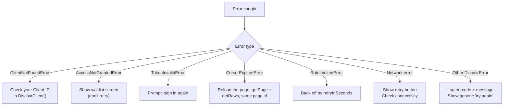

SDK recovers from most authentication errors automatically. This guide helps you handle the exceptions and show appropriate messages to users.

Typical entry points: [`signInWithPopup()`](/sdk-reference/authentication/sign-in-with-popup), [`signInWithWebAuth()`](/sdk-reference/authentication/sign-in-with-web-auth), [`signInWithDeviceCode()`](/sdk-reference/authentication/sign-in-with-device-code), then [`selectProfile()`](/sdk-reference/authentication/select-profile) and API calls such as [`createPage()`](/sdk-reference/pages/create-page).



## When sign-in fails

{/* sample: reference-error-handling-when-sign-in-fails */}

<CodeGroup>

```typescript TypeScript
import { DiscovrError, ClientNotFoundError, TokenInvalidError } from "discovr";

try {
	await client.signInWithDeviceCode();
	// If successful, continue to selectProfile()
} catch (err) {
	if (err instanceof ClientNotFoundError) {
		// clientID is not registered — check your configuration
		console.log("Invalid client ID. Check your app configuration.");
	} else if (err instanceof TokenInvalidError) {
		// The auth token was rejected
		console.log("Authentication failed. Sign in again.");
	} else if (err instanceof DiscovrError) {
		// Any other typed SDK error
		console.log("Sign-in failed:", err.code, err.message);
	} else {
		console.log("Unexpected error:", (err as Error).message);
	}
}
```

```kotlin Kotlin
import api.discovr.DiscovrClient
import api.discovr.auth.ClientNotFoundError
import api.discovr.auth.DiscovrError
import api.discovr.auth.TokenInvalidError

suspend fun handleSignInErrors(client: DiscovrClient) {
    try {
        client.signInWithDeviceCode()
        // If successful, continue to selectProfile()
    } catch (e: ClientNotFoundError) {
        // clientID is not registered — check your configuration
        println("Invalid client ID. Check your app configuration.")
    } catch (e: TokenInvalidError) {
        // The auth token was rejected
        println("Authentication failed. Sign in again.")
    } catch (e: DiscovrError) {
        // Any other typed SDK error
        println("Sign-in failed: ${e.message}")
    }
}
```

```swift Swift
import Discovr

func handleSignInErrors(client: DiscovrClient) async {
    do {
        _ = try await client.signInWithDeviceCode()
        // If successful, continue to selectProfile()
    } catch AuthError.clientNotFound {
        print("Invalid client ID. Check your app configuration.")
    } catch AuthError.tokenInvalid {
        print("Authentication failed. Sign in again.")
    } catch {
        print("Sign-in error: \(error)")
    }
}
```

</CodeGroup>

**What to do:**

- **User cancelled:** Don't show error. User made a choice.
- **Network error:** Show retry button. Prompt: "Check your connection and try again."
- **Invalid credentials:** Show error. Prompt: "Email or password incorrect. Try again."
- **Other errors:** Show generic message. Prompt: "Sign-in failed. Try again."

## When API calls fail

Every actionable error condition — rate limits, waitlist status, terms acceptance, missing profiles, and expired pagination cursors — surfaces as a **typed SDK error** across all three languages and every tier (auth, identity, session, and public). Everything else arrives as an HTTP status you branch on.

**Rate limits** always carry a typed `retryInSeconds` wait from the server:

{/* sample: reference-error-handling-when-api-calls-fail */}

<CodeGroup>

```typescript TypeScript
import { RateLimitedError } from "discovr";

try {
	await client.getRows(pageId);
} catch (err) {
	if (err instanceof RateLimitedError) {
		// Seconds until the window rolls over, from the server. Capped at 5 minutes.
		console.log(`Slow down — try again in ${err.retryInSeconds}s.`);
		return;
	}
	throw err;
}
```

```kotlin Kotlin
try {
    client.getRows(pageId)
} catch (err: RateLimitedError) {
    println("Slow down — try again in ${err.retryInSeconds}s.")
}
```

```swift Swift
do {
    _ = try await client.getRows(pageId: pageId)
} catch AuthError.rateLimited(let retryInSeconds) {
    print("Slow down — try again in \(retryInSeconds)s.")
}
```

</CodeGroup>

Catch the typed errors first, then fall back to the HTTP status:

{/* sample: reference-error-handling-when-api-calls-fail-2 */}

<CodeGroup>

```typescript TypeScript
// Ordinary HTTP failures carry the response. Narrow it before reading the status.
function httpStatus(err: unknown): number | undefined {
	const res = (err as { response?: { status?: number } }).response;
	return typeof res?.status === "number" ? res.status : undefined;
}

try {
	const page = await client.createPage();
	// Use page normally
} catch (err) {
	if (err instanceof AccessNotGrantedError) {
		// Account is still on the waitlist — show a waitlist screen, don't retry.
		console.log("Your account isn't active yet.");
		return;
	}
	if (err instanceof LegalAcceptanceRequiredError) {
		console.log("Please accept the latest Terms to continue.");
		return;
	}
	if (err instanceof CursorExpiredError) {
		// A pagination token is no longer usable, typically because the
		// recommendations turned over. The page id is still good: reload the
		// page (getPage + getRows, no token) and replace what you're showing.
		await restartPagination();
		return;
	}
	switch (httpStatus(err)) {
		case 401:
			// The user is signed out. Nothing else produces a 401 any more.
			await showSignInUI();
			break;
		case 403:
			// The SDK sent the wrong kind of credential — a bug, not a user problem.
			console.log("Internal error. Please report this if it keeps happening.");
			break;
		case undefined:
			// Never reached Discovr.
			console.log("Network error. Check your connection and retry.");
			break;
		default:
			console.log("Something went wrong. Try again.");
	}
}
```

```kotlin Kotlin
import api.discovr.DiscovrException

try {
    val page = client.createPage()
} catch (_: AccessNotGrantedError) {
    println("Your account isn't active yet.")
} catch (_: LegalAcceptanceRequiredError) {
    println("Please accept the latest Terms to continue.")
} catch (_: CursorExpiredError) {
    restartPagination()
} catch (e: DiscovrException) {
    when (e.statusCode) {
        401 -> showSignInUI()
        403 -> println("Internal error. Please report this if it keeps happening.")
        else -> println("Something went wrong. Try again.")
    }
} catch (e: Exception) {
    println("Network error. Check your connection and retry.")
}
```

```swift Swift
import Discovr

@MainActor
func handleAPICallErrors() async {
    let client = await DiscovrClient(clientId: "your-client-id")

    do {
        let page = try await client.createPage()
        // Use page normally
        print(page.id)
    } catch AuthError.accessNotGranted {
        // Account is still on the waitlist — show a waitlist screen, don't retry.
        print("Your account isn't active yet.")
    } catch AuthError.legalAcceptanceRequired {
        // Account needs to accept the latest Terms before continuing.
        print("Please accept the latest Terms to continue.")
    } catch AuthError.cursorExpired {
        // A pagination token is no longer usable, typically because the
        // recommendations turned over. The page id is still good: reload the
        // page (getPage + getRows, no token) and replace what you're showing.
        restartPagination()
    } catch AuthError.rateLimited(let retryInSeconds) {
        print("Too many requests. Try again in \(retryInSeconds)s.")
    } catch ErrorResponse.error(401, _, _, _) {
        // The user is signed out. Nothing else produces a 401 any more.
        showSignInUI()
    } catch ErrorResponse.error(403, _, _, _) {
        print("Internal error. Please report this if it keeps happening.")
    } catch {
        print("Network error. Check your connection and retry.")
    }
}
```

</CodeGroup>

<Note>
	A `401` means exactly one thing: the user is signed out. Page ids never expire, so a page or row
	call can't produce one for any other reason.
</Note>

**Error mapping:**

Actionable failures arrive as **typed error classes** across every tier (sign-in, identity, session, and public). Everything else arrives as an **HTTP status** you branch on.

**Typed errors — catch by type (all tiers):**

| Error class (TS / Kotlin)      | Swift (`AuthError`)             | Wire code (`error`)            | What to do                                                              |
| ------------------------------ | ------------------------------- | ------------------------------ | ----------------------------------------------------------------------- |
| `ClientNotFoundError`          | `.clientNotFound`               | `client-not-found`             | Check your Client ID in `DiscovrClient()`.                              |
| `TokenInvalidError`            | `.tokenInvalid`                 | `token-invalid`                | Prompt the user to sign in again.                                       |
| `AccessNotGrantedError`        | `.accessNotGranted`             | `access-not-granted`           | Account is on the waitlist — show a waitlist screen, don't retry.       |
| `LegalAcceptanceRequiredError` | `.legalAcceptanceRequired`      | `legal-acceptance-required`    | Ask the user to accept the latest Terms before continuing.              |
| `ProfileNotFoundError`         | `.profileNotFound`              | `profile-not-found`            | The profile no longer exists — return to the profile picker.            |
| `CursorExpiredError`           | `.cursorExpired`                | `cursor-expired`               | Reload the page (`getPage` + `getRows`, no token) and replace the list. |
| `RateLimitedError`             | `.rateLimited(retryInSeconds:)` | `rate-limited`                 | Back off by `retryInSeconds`, then retry.                               |
| `SessionExpiredError`          | `.sessionExpired`               | `session-expired`              | Sign-in window expired — start sign-in again.                           |
| `SessionConsumedError`         | `.sessionConsumed`              | `session-already-consumed`     | Sign-in link already used — start sign-in again.                        |
| `DeviceCodeExpiredError`       | `.deviceCodeExpired`            | `device-code-expired`          | Device code expired — request a new one.                                |
| `DeviceCodeConsumedError`      | `.deviceCodeConsumed`           | `device-code-already-consumed` | Code already used — request a new one.                                  |
| `DeviceCodeDeniedError`        | `.deviceCodeDenied`             | `device-code-denied`           | Declined on the phone — offer to try again.                             |
| `AuthCancelledError`           | `.cancelled`                    | `authorization-cancelled`      | Nothing: the person chose to stop.                                      |
| `NotSignedInError`             | `.notSignedIn`                  | —                              | Prompt the user to sign in.                                             |

<Warning>
	`SessionExpiredError` is about the **sign-in window**, not a browsing session. A pagination cursor
	that goes stale surfaces as `CursorExpiredError` (`409 cursor-expired`), never as this class.
</Warning>

**Other HTTP failures — branch on status:**

| Status        | Wire code (`error`)                      | What to do                                                                          |
| ------------- | ---------------------------------------- | ----------------------------------------------------------------------------------- |
| `401`         | `token-invalid` / `token-expired`        | The user is signed out. Show the sign-in UI.                                        |
| `403`         | `wrong-token-kind` / `permission-denied` | If not one of the typed 403s above, show a generic error and report if it persists. |
| `404`         | `not-found`                              | The resource doesn't exist. Go back to a known-good page.                           |
| `409`         | `duplicate`                              | The item already exists.                                                            |
| `500` / `503` | `internal-error` / `service-unavailable` | "Something went wrong. Try again."                                                  |
| No status     | —                                        | The request never left the device. "Check your connection and try again."           |

## Rate limits

Discovr applies per-endpoint-group rate limits to keep the service responsive. Limits are enforced per user (within your app) on authenticated endpoints and per IP on unauthenticated sign-in and media-lookup endpoints:

| Endpoint group                                                                                                                                                                                 | Limit                                      | Scope    |
| ---------------------------------------------------------------------------------------------------------------------------------------------------------------------------------------------- | ------------------------------------------ | -------- |
| Page creation (`createPage`)                                                                                                                                                                   | 12 / min                                   | Per user |
| Search (`searchMedia`)                                                                                                                                                                         | 25 / min                                   | Per user |
| Avatar gallery & GIF search (`getProfileImages`, `searchGifs`)                                                                                                                                 | 25 / min                                   | Per IP   |
| Browsing, media details, profiles, lists, title state, scrobbling (`getPage`, `getRows`, `getRowItems`, `getMedia`, `getTitleState`, `setRating`, `scrobble`, `markWatched`, `getProfiles`, …) | 60 / min                                   | Per user |
| Profile session minting, auth sessions, legal acceptance (`selectProfile`, `switchProfile`, …)                                                                                                 | 20 / min                                   | Per user |
| Web sign-in authorize / token exchange                                                                                                                                                         | 20 / min (authorize) · 30 / min (exchange) | Per IP   |
| Device-code sign-in requests (`signInWithDeviceCode`)                                                                                                                                          | 60 / hour                                  | Per IP   |
| Demo sandbox creation (`signInWithDemo`)                                                                                                                                                       | 5 / hour                                   | Per IP   |

When you exceed a limit, the API responds with `429 rate-limited` and the SDK throws `RateLimitedError` (`AuthError.rateLimited(retryInSeconds:)` in Swift). Wait `retryInSeconds` seconds before retrying — retrying immediately keeps the bucket full and extends the throttle.

## SDK error recovery

SDK automatically handles:

- **Token refresh:** Before token expires, SDK mints a fresh one. Transparent to your code.
- **Retry logic:** If token expires mid-request, SDK refreshes and retries. You see no errors.

A `409 cursor-expired` (`CursorExpiredError` / `AuthError.cursorExpired`) is the one data-call failure the SDK doesn't recover from for you — reload
that page with `getPage` and `getRows` (no token) and replace what you're showing (see the table
above and [Recommendations](/guides/recommendations)).

You mainly need to catch:

- Sign-in failures (network, cancelled, auth failure)
- Persistent token errors (token truly invalid/revoked)
- Network errors (timeout, connectivity)

<Tip>
	Most errors are handled automatically. You primarily need to handle sign-in failures and
	persistent authentication errors.
</Tip>

## Error handling best practices

**Do:**

- Show user-friendly messages ("Sign-in failed. Try again.")
- Provide retry buttons for network errors
- Log errors for debugging (but never log tokens)
- Handle offline gracefully

**Don't:**

- Show technical error messages to users ("TOKEN_EXPIRED_INVALID_SIGNATURE")
- Log or expose tokens
- Retry indefinitely without backoff
- Assume error codes—catch the SDK's typed error classes instead of matching wire strings directly

## Related SDK reference

[signInWithPopup](/sdk-reference/authentication/sign-in-with-popup) · [signInWithWebAuth](/sdk-reference/authentication/sign-in-with-web-auth) · [signInWithDeviceCode](/sdk-reference/authentication/sign-in-with-device-code) · [selectProfile](/sdk-reference/authentication/select-profile) · [createPage](/sdk-reference/pages/create-page)

---

Reference — you don't need to read this end to end. See also [Security](/guides/reference/security) for token handling, and [Recommendations](/guides/recommendations) for the `409 cursor-expired` case specifically.
