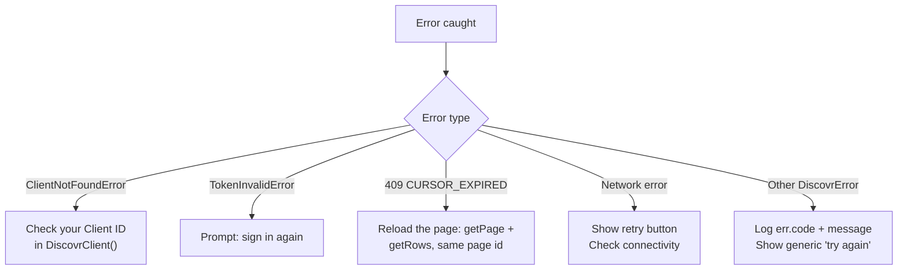

SDK recovers from most authentication errors automatically. This guide helps you handle the exceptions and show appropriate messages to users.

Typical entry points: [`signInWithPopup()`](/sdk-reference/authentication/sign-in-with-popup), [`signInWithWebAuth()`](/sdk-reference/authentication/sign-in-with-web-auth), [`signInWithDeviceCode()`](/sdk-reference/authentication/sign-in-with-device-code), then [`selectProfile()`](/sdk-reference/authentication/select-profile) and API calls such as [`createPage()`](/sdk-reference/pages/create-page).



## When sign-in fails

{/* sample: reference-error-handling-when-sign-in-fails */}

<CodeGroup>

```typescript TypeScript
import { DiscovrError, ClientNotFoundError, TokenInvalidError } from "discovr";

try {
	await client.signInWithDeviceCode();
	// If successful, continue to selectProfile()
} catch (err) {
	if (err instanceof ClientNotFoundError) {
		// clientID is not registered — check your configuration
		console.log("Invalid client ID. Check your app configuration.");
	} else if (err instanceof TokenInvalidError) {
		// The auth token was rejected
		console.log("Authentication failed. Sign in again.");
	} else if (err instanceof DiscovrError) {
		// Any other typed SDK error
		console.log("Sign-in failed:", err.code, err.message);
	} else {
		console.log("Unexpected error:", (err as Error).message);
	}
}
```

```kotlin Kotlin
import api.discovr.DiscovrClient
import api.discovr.auth.ClientNotFoundError
import api.discovr.auth.DiscovrError
import api.discovr.auth.TokenInvalidError

suspend fun handleSignInErrors(client: DiscovrClient) {
    try {
        client.signInWithDeviceCode()
        // If successful, continue to selectProfile()
    } catch (e: ClientNotFoundError) {
        // clientID is not registered — check your configuration
        println("Invalid client ID. Check your app configuration.")
    } catch (e: TokenInvalidError) {
        // The auth token was rejected
        println("Authentication failed. Sign in again.")
    } catch (e: DiscovrError) {
        // Any other typed SDK error
        println("Sign-in failed: ${e.message}")
    }
}
```

```swift Swift
import Discovr

func handleSignInErrors(client: DiscovrClient) async {
    do {
        _ = try await client.signInWithDeviceCode()
        // If successful, continue to selectProfile()
    } catch AuthError.clientNotFound {
        print("Invalid client ID. Check your app configuration.")
    } catch AuthError.tokenInvalid {
        print("Authentication failed. Sign in again.")
    } catch {
        print("Sign-in error: \(error)")
    }
}
```

</CodeGroup>

**What to do:**

- **User cancelled:** Don't show error. User made a choice.
- **Network error:** Show retry button. Prompt: "Check your connection and try again."
- **Invalid credentials:** Show error. Prompt: "Email or password incorrect. Try again."
- **Other errors:** Show generic message. Prompt: "Sign-in failed. Try again."

## When API calls fail

The typed errors above belong to the sign-in flow. Once you're signed in, failures on data calls — [`createPage()`](/sdk-reference/pages/create-page) and every other session-scoped request — mostly arrive as HTTP errors, so branch on the **status code**.

**One exception: rate limits.** TypeScript and Kotlin turn a `429` into a typed `RateLimitedError` before it ever reaches your status check, so a `case 429:` there never fires. Catch the type instead and use the wait it carries:

{/* sample: reference-error-handling-when-api-calls-fail */}

<CodeGroup>

```typescript TypeScript
import { RateLimitedError } from "discovr";

try {
	await client.getRows(pageId);
} catch (err) {
	if (err instanceof RateLimitedError) {
		// Seconds until the window rolls over, from the server. Capped at 5 minutes.
		console.log(`Slow down — try again in ${err.retryInSeconds}s.`);
		return;
	}
	throw err;
}
```

```kotlin Kotlin
try {
    client.getRows(pageId)
} catch (err: RateLimitedError) {
    println("Slow down — try again in ${err.retryInSeconds}s.")
}
```

```swift Swift
// Swift is the exception to the exception. On the session tier a 429 surfaces
// as the generated `ErrorResponse`, not a typed error, so branch on the status
// as you would for any other data-call failure — see the switch below.
// Identity-tier calls (sign-in, profile selection) do throw
// `AuthError.rateLimited(retryInSeconds:)`.
do {
    _ = try await client.getRows(pageId: pageId)
} catch ErrorResponse.error(429, _, let response, _) {
    let retryAfter = (response as? HTTPURLResponse)?.value(forHTTPHeaderField: "Retry-After")
    print("Slow down — try again in \(retryAfter ?? "a few")s.")
}
```

</CodeGroup>

<Note>
	The asymmetry is a platform constraint, not an oversight. Swift's session-tier calls go through
	generated retry infrastructure whose result type carries no slot for a custom error, so the thrown
	value can't be swapped for a typed one without changing the code generator itself. It's the same
	reason a signed-out Swift session surfaces `ErrorResponse` rather than `TokenInvalidError`.
</Note>

Everything else branches on the status code:

{/* sample: reference-error-handling-when-api-calls-fail-2 */}

<CodeGroup>

```typescript TypeScript
// Data-call failures carry the HTTP response. Narrow it before reading the status.
function httpStatus(err: unknown): number | undefined {
	const res = (err as { response?: { status?: number } }).response;
	return typeof res?.status === "number" ? res.status : undefined;
}

try {
	const page = await client.createPage();
	// Use page normally
} catch (err) {
	switch (httpStatus(err)) {
		case 401:
			// The user is signed out. Nothing else produces a 401 any more.
			await showSignInUI();
			break;
		case 409:
			// A pagination token is no longer usable, typically because the
			// recommendations turned over. The page id is still good: reload the
			// page (getPage + getRows, no token) and replace what you're showing.
			await restartPagination();
			break;
		case 403:
			// The SDK sent the wrong kind of credential — a bug, not a user problem.
			console.log("Internal error. Please report this if it keeps happening.");
			break;
		case undefined:
			// Never reached Discovr.
			console.log("Network error. Check your connection and retry.");
			break;
		default:
			console.log("Something went wrong. Try again.");
	}
}
```

```kotlin Kotlin
import api.discovr.DiscovrException

try {
    val page = client.createPage()
} catch (e: DiscovrException) {
    when (e.statusCode) {
        401 -> showSignInUI()
        409 -> restartPagination()
        403 -> println("Internal error. Please report this if it keeps happening.")
        else -> println("Something went wrong. Try again.")
    }
} catch (e: Exception) {
    println("Network error. Check your connection and retry.")
}
```

```swift Swift
import Discovr

@MainActor
func handleAPICallErrors() async {
    let client = await DiscovrClient(clientId: "your-client-id")

    do {
        let page = try await client.createPage()
        // Use page normally
        print(page.id)
    } catch ErrorResponse.error(401, _, _, _) {
        // The user is signed out. Nothing else produces a 401 any more.
        showSignInUI()
    } catch ErrorResponse.error(409, _, _, _) {
        // A pagination token is no longer usable, typically because the
        // recommendations turned over. The page id is still good: reload the
        // page (getPage + getRows, no token) and replace what you're showing.
        restartPagination()
    } catch ErrorResponse.error(429, _, _, _) {
        // Swift only: TypeScript and Kotlin throw a typed RateLimitedError.
        print("Too many requests. Try again in a moment.")
    } catch ErrorResponse.error(403, _, _, _) {
        print("Internal error. Please report this if it keeps happening.")
    } catch {
        print("Network error. Check your connection and retry.")
    }
}
```

</CodeGroup>

<Note>
	A `401` means exactly one thing: the user is signed out. Page ids never expire, so a page or row
	call can't produce one for any other reason.
</Note>

**Error mapping:**

Sign-in failures arrive as **typed error classes** you can catch by type. Data-call failures arrive as **HTTP statuses** you branch on.

**Sign-in — catch by type:**

| Error class               | Where it occurs         | What to show user                                       |
| ------------------------- | ----------------------- | ------------------------------------------------------- |
| `ClientNotFoundError`     | Any sign-in flow        | "Invalid client ID. Check your app configuration."      |
| `TokenInvalidError`       | Sign-in                 | "Authentication failed. Sign in again."                 |
| `SessionExpiredError`     | Web sign-in             | "Sign-in window expired. Please try again."             |
| `SessionConsumedError`    | Web sign-in             | "This sign-in link was already used. Please try again." |
| `DeviceCodeExpiredError`  | Device code flow        | "Code expired. Generate a new one."                     |
| `DeviceCodeConsumedError` | Device code polling     | "This code was already used. Generate a new one."       |
| `DeviceCodeDeniedError`   | Device code polling     | "Sign-in was declined on your phone."                   |
| `AuthCancelledError`      | Any sign-in flow        | Nothing: the person chose to stop.                      |
| `NotSignedInError`        | Any call before sign-in | "Please sign in to continue."                           |

<Warning>
	`SessionExpiredError` is about the **sign-in window**, not a browsing session. A pagination cursor
	that goes stale surfaces as `409 CURSOR_EXPIRED` on the data call, never as this class.
</Warning>

**Data calls — branch on status:**

| Status        | What it means                                                                       | What to do                                                                      |
| ------------- | ----------------------------------------------------------------------------------- | ------------------------------------------------------------------------------- |
| `401`         | The user is signed out. Nothing else produces one.                                  | Show the sign-in UI.                                                            |
| `403`         | The wrong kind of credential was sent — an SDK bug.                                 | "Internal error." [Report it](https://discoverapi.userjot.com/) if it persists. |
| `404`         | The page or row doesn't exist.                                                      | Go back to a known-good page.                                                   |
| `409`         | Your pagination token is no longer usable, usually after a recommendation turnover. | Call `getPage` and `getRows` with no token, and replace what you're showing.    |
| `429`         | Rate limited. **TypeScript and Kotlin throw `RateLimitedError` instead of this.**   | Back off by `retryInSeconds`, then retry.                                       |
| `500` / `503` | Discovr had a problem.                                                              | "Something went wrong. Try again."                                              |
| No status     | The request never left the device.                                                  | "Check your connection and try again."                                          |

## SDK error recovery

SDK automatically handles:

- **Token refresh:** Before token expires, SDK mints a fresh one. Transparent to your code.
- **Retry logic:** If token expires mid-request, SDK refreshes and retries. You see no errors.

A `409 CURSOR_EXPIRED` is the one data-call failure the SDK doesn't recover from for you — reload
that page with `getPage` and `getRows` (no token) and replace what you're showing (see the table
above and [Recommendations](/guides/recommendations)).

You mainly need to catch:

- Sign-in failures (network, cancelled, auth failure)
- Persistent token errors (token truly invalid/revoked)
- Network errors (timeout, connectivity)

<Tip>
	Most errors are handled automatically. You primarily need to handle sign-in failures and
	persistent authentication errors.
</Tip>

## Error handling best practices

**Do:**

- Show user-friendly messages ("Sign-in failed. Try again.")
- Provide retry buttons for network errors
- Log errors for debugging (but never log tokens)
- Handle offline gracefully

**Don't:**

- Show technical error messages to users ("TOKEN_EXPIRED_INVALID_SIGNATURE")
- Log or expose tokens
- Retry indefinitely without backoff
- Assume error codes—check for multiple possible codes (e.g., both `TOKEN_INVALID` and `TOKEN_EXPIRED`)

## Related SDK reference

[signInWithPopup](/sdk-reference/authentication/sign-in-with-popup) · [signInWithWebAuth](/sdk-reference/authentication/sign-in-with-web-auth) · [signInWithDeviceCode](/sdk-reference/authentication/sign-in-with-device-code) · [selectProfile](/sdk-reference/authentication/select-profile) · [createPage](/sdk-reference/pages/create-page)

---

Reference — you don't need to read this end to end. See also [Security](/guides/reference/security) for token handling, and [Recommendations](/guides/recommendations) for the `409 CURSOR_EXPIRED` case specifically.
