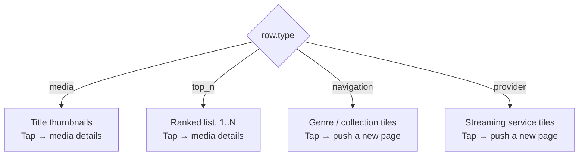

## What is a row?

**Rows** are the horizontal recommendation rails on a [page](/guides/pages)—each row is a scrollable list of titles, categories, or streaming providers. After you fetch a page, you paginate through its rows and load items (titles) from each row your user scrolls into.

Rows come in four types. The row's `type` tells you which cell layout to use, and — just as importantly — what should happen when the user taps one:



The two on the left open a title. The two on the right hand you a new `pageId` to push onto your navigation stack — see [Navigation](/guides/navigation).

<Note>
	Rows need an active profile — start with
	[`selectProfile()`](/sdk-reference/authentication/select-profile), covered in
	[Profiles](/guides/profiles). Code snippets use **TypeScript**, **Kotlin**, and **Swift** tabs.
</Note>

## How rows surface in your app

Rendering a page is a two-step call:

1. **Row shells** — [`getRows()`](/sdk-reference/rows/get-rows) returns the row list for a page: title, type, and id. Paginated. Call this when the page loads.
2. **Row items** — [`getRowItems()`](/sdk-reference/rows/get-row-items) fetches the tiles for one row. Call it only when the user scrolls that row into view.

Check `row.type` to choose a layout; check each item’s `type` to render the right cell. Full field shapes are in [Type reference](/sdk-reference/types) — [Row](/sdk-reference/types/rows#row), [Media items](/sdk-reference/types/rows#mediaitem), [Navigation items](/sdk-reference/types/rows#navigationitem), [Provider items](/sdk-reference/types/rows#provideritem).

<Tip>
	Page IDs are permanent — a page/rows call never fails because the page "expired". If the rows
	behind a page have turned over, [`getRows()`](/sdk-reference/rows/get-rows) with no token just
	returns the new ranking. What goes stale is a **rows pagination token**: after a turnover it's
	refused with `409 CURSOR_EXPIRED`. Reload with `getPage(pageId)` and `getRows(pageId)`, replace
	what you're showing, and drop the old row IDs. Paging **row items** for rows you already hold
	stays usable while you finish scrolling a rail. See [Recommendations](/guides/recommendations).
</Tip>

## `media` rows

Classic **horizontal title rails**: items are **`type: "media"`** with poster/backdrop URLs and **`media_type`** (`movie` or `tv`). Use the same cell layout you would for any browse strip.

Each item also carries **`year`**, **`rating`** (out of 10) and **`genres`** whenever they're known, which is enough for a one-line spotlight under the focused tile without another request. Anything more (runtime, cast, a title logo) comes from [`getMedia()`](/sdk-reference/media/get-media) when focus lands on a tile; the SDK keeps those responses for the session, so only the first visit to a title pays for the call.

<Frame>
	
	
</Frame>

## `top_n` rows

**Visually**, treat **`top_n`** like **`media`**: items are still **media-shaped** (same fields as media items). Discovr uses the separate **`top_n`** row **`type`** to signal **editorial “top‑N”** style rails versus generic media mixes—useful if you want different labels, ordering emphasis, or analytics. If you only need one poster rail renderer, **`media`** and **`top_n`** can share it—the only extra signal is **`type: "top_n"`** on the enclosing **`Row`**.

<Frame>
	
	
</Frame>

## `navigation` rows

**Navigation rows** surface **destination pages**: each item is **`type: "navigation"`** and carries **`page_id`** for where to **push** next (stack depth lives in [Pages overview](/guides/pages)). Each tile has a **`title`** and, usually, finished artwork in **`horizontal_path`** (landscape) and **`vertical_path`** (portrait), each in a full-size and a thumbnail version.

<Warning>
	The tile artwork is a finished image: the title (and the path that leads to it, like "Movies &
	Series") is already drawn into it. Show the image on its own. If you draw `title` on top, your
	users will see it twice. Keep `title` for accessibility labels and for tiles that come back
	without art, where you'll need to draw your own.
</Warning>

<Frame>
	
	
</Frame>

## `provider` rows

**Provider rails** list **streaming services**: each **`type: "provider"`** tile exposes **`paths`** (square logo URLs keyed roughly by size—`"60"`, `"100"`, …) and a **`page_id`** for that **provider hub**. After a tap, load that page with [`getPage()`](/sdk-reference/pages/get-page) / [`getRows()`](/sdk-reference/rows/get-rows).

<Frame>
	
	
</Frame>

| Row type     | Items contain                | Use it for                  |
| ------------ | ---------------------------- | --------------------------- |
| `media`      | Posters, title, `media_type` | Standard browse rails       |
| `top_n`      | Same as media                | Editorial "Top 10" styling  |
| `navigation` | `title`, tile art, `page_id` | Category drill-down         |
| `provider`   | Logo URLs, `page_id`         | Filter by streaming service |

### How to draw each row

Discovr tells you what a row contains, not how to lay it out, so the row `type` is your cue. A reasonable starting point:

| Row type     | Cell shape                                                                                       |
| ------------ | ------------------------------------------------------------------------------------------------ |
| `media`      | Posters (portrait) or backdrops (landscape), whichever suits your layout. Be consistent per row. |
| `top_n`      | The same cell as `media`, with a rank number if you want the "Top 10" look.                      |
| `navigation` | The tile art as given. `horizontal_path` is landscape (16:9) and `vertical_path` is portrait.    |
| `provider`   | Square logos from `paths`.                                                                       |

## Load rows and items

After you have a **`pageId`** (from [`createPage()`](/sdk-reference/pages/create-page) or a **`page_id`** on an item), fetch row metadata, then items for the rails you render.

{/* sample: rows-load-rows-and-items */}

<CodeGroup>

```typescript TypeScript
import { DiscovrClient } from "discovr";

const client = new DiscovrClient("your-client-id");

const pageId = "your-page-id";
const { rows, hasMore, nextPageToken } = await client.getRows(pageId, { limit: 10 });

for (const row of rows) {
	switch (row.type) {
		case "media":
		case "top_n":
			break;
		case "navigation":
		case "provider":
			break;
	}
}

const first = rows[0];
if (first) {
	const items = await client.getRowItems(pageId, first.id, { limit: 20 });
	for (const item of items.items) {
		if (item.type === "media") {
			console.log(item.title, item.mediaType);
		} else if (item.type === "navigation" || item.type === "provider") {
			console.log(item.title, item.pageId);
		}
	}
}
```

```kotlin Kotlin
import api.discovr.DiscovrClient
import api.discovr.models.RowType

suspend fun loadRailsWithItems(client: DiscovrClient, pageId: String) {
	val bundle = client.getRows(pageId = pageId, limit = 10)
	for (row in bundle.rows) {
		when (row.type) {
			RowType.media, RowType.top_n -> { /* title rail */ }
			RowType.navigation, RowType.provider -> { /* tiles / logos */ }
		}
	}
	val first = bundle.rows.firstOrNull() ?: return
	val items = client.getRowItems(pageId = pageId, rowId = first.id, limit = 20)
	for (item in items.items) {
		// Narrow each Item to MediaItem / NavigationItem / ProviderItem (your generated SDK’s union helpers)
		println(item)
	}
}
```

```swift Swift
import Discovr

func loadRails(client: DiscovrClient, pageId: String) async throws {
	let bundle = try await client.getRows(pageId: pageId, limit: 10)
	for row in bundle.rows {
		switch row.type {
		case .media, .topN:
			break
		case .navigation, .provider:
			break
		}
	}
	guard let first = bundle.rows.first else { return }
	let items = try await client.getRowItems(pageId: pageId, rowId: first.id, limit: 20)
	for item in items.items {
		switch item {
		case .typeMediaItem(let m):
			print(m.title, m.mediaType)
		case .typeNavigationItem(let n):
			print(n.title, n.pageId)
		case .typeProviderItem(let p):
			print(p.title, p.pageId)
		}
	}
}
```

</CodeGroup>

## Pass the `ref` when your user acts

Every title Discovr hands you — in rows and the hero, in search results, under "more like this", in a person's known-for titles, and in your user's lists — carries a **`ref`** alongside its `id`. It's the same identifier, with where your user found it attached.

It works anywhere the plain id does, and it's how Discovr learns what's working for each profile: the more of your user's actions carry it, the sharper their next recommendations get. So use the `ref` whenever your user **does** something or **moves** somewhere:

- opening a title's detail screen
- liking it, adding it to a list, or scrobbling it
- drilling into the page a navigation or provider tile links to
- jumping from one title to another

{/* sample: rows-pass-the-ref-when-your-user-acts */}

<CodeGroup>

```typescript TypeScript
import { refOrId } from "discovr";

// Opening a title from a row
const details = await client.getMedia(refOrId(item));
await client.addLikedItem(refOrId(item));

// Drilling into a navigation or provider tile
const page = await client.getPage(refOrId(tile));
```

```kotlin Kotlin
import api.discovr.refOrId

val details = client.getMedia(mediaId = item.refOrId())
client.addLikedItem(mediaId = item.refOrId())

val page = client.getPage(pageId = tile.refOrId())
```

```swift Swift
let details = try await client.getMedia(mediaId: item.refOrId)
try await client.addLikedItem(mediaId: item.refOrId)

let page = try await client.getPage(pageId: tile.refOrId)
```

</CodeGroup>

`refOrId` picks the right value for whichever kind of item you give it — media items are keyed by their title id, navigation and provider tiles by the page they open — and falls back to the plain id when no `ref` is present.

### Use the `id` to name a title

Anything that just _names_ a title — a link someone might share, a cache key, a log line — is better served by the plain `id`. Keep your URLs canonical (`/title/MV_550`) so shared links and bookmarks keep working, and carry the `ref` alongside in your navigation state. A title's details are the same whichever row your user found it in, so key your caches on the `id` too — and keep sending the `ref` with the calls themselves.

{/* sample: rows-use-the-id-to-name-a-title */}

<CodeGroup>

```typescript TypeScript
import { idOf, refOrId } from "discovr";

// Tapping a tile: the URL names the title, the navigation state carries the ref
navigate(`/title/${item.id}`, { state: { ref: refOrId(item) } });

// On the detail screen: act with the ref, name the title with the id
const { id } = useParams();
const ref = useLocation().state?.ref ?? id; // opened from a shared link? the id works too
const details = await client.getMedia(ref);
await client.addLikedItem(ref);

// Holding only a ref, like a saved "recently viewed" entry? idOf gets the id back.
const cacheKey = idOf(savedRef);
```

```kotlin Kotlin
import api.discovr.idOf
import api.discovr.refOrId

// Tapping a tile: the screen is named by the id and carries the ref along
val screen = TitleScreen(id = item.id, ref = item.refOrId())

// On the detail screen: act with the ref, name the title with the id
val details = client.getMedia(mediaId = screen.ref)
client.addLikedItem(mediaId = screen.ref)

// Holding only a ref, like a saved "recently viewed" entry? idOf gets the id back.
val cacheKey = idOf(savedRef)
```

```swift Swift
// Tapping a tile: the route is named by the id and carries the ref along
path.append(TitleRoute(id: item.id, ref: item.refOrId))

// On the detail screen: act with the ref, name the title with the id
let details = try await client.getMedia(mediaId: route.ref)
try await client.addLikedItem(mediaId: route.ref)

// Holding only a ref, like a saved "recently viewed" entry? idOf gets the id back.
let cacheKey = idOf(savedRef)
```

</CodeGroup>

`idOf` also accepts a plain `id` and hands it straight back, so it's safe to call on either.

<Note>
	A bare `id` always works. `ref` is never required, and nothing breaks if you don't pass it — you
	just lose the signal that would have improved the recommendations that user sees next. A `ref`
	belongs to the profile it was returned to, so use it for that profile's actions and don't save it
	across profiles or send it to other people. If one ends up with a different profile, it's treated
	as a plain `id`.
</Note>

## Related reading

- [Pages overview](/guides/pages) — hero + rows, tabs, stack navigation and depth
- [Media details](/guides/media) — after a **`media`** / **`top_n`** tap: catalog, images, seasons, similar
- [Profile context](/guides/profile-context) — lists, playback, scrobbling (not row types)—see after you wire tiles
- [Error handling](/guides/reference/error-handling) — which failures are the user's, and which are the page's
- [User UX: Lazy Loading](/guides/navigation/lazy-loading) — paginate rows and items efficiently; load on scroll
- [Recommendations](/guides/recommendations) — recover when a pagination cursor outlives its results
- [Type reference](/sdk-reference/types) — **`Row`**, **Row item** wire fields (media / navigation / provider)
- SDK: [`getRows()`](/sdk-reference/rows/get-rows) · [`getRow()`](/sdk-reference/rows/get-row) · [`getRowItems()`](/sdk-reference/rows/get-row-items)
- HTTP: **[Get rows for a page](/api-reference/discovr/get-rows)** · **[Get a row](/api-reference/discovr/get-row)** · **[Get items in a row](/api-reference/discovr/get-row-items)**

---

**Next:** [Recommendations — how the rows behind a page refresh](/guides/recommendations)
